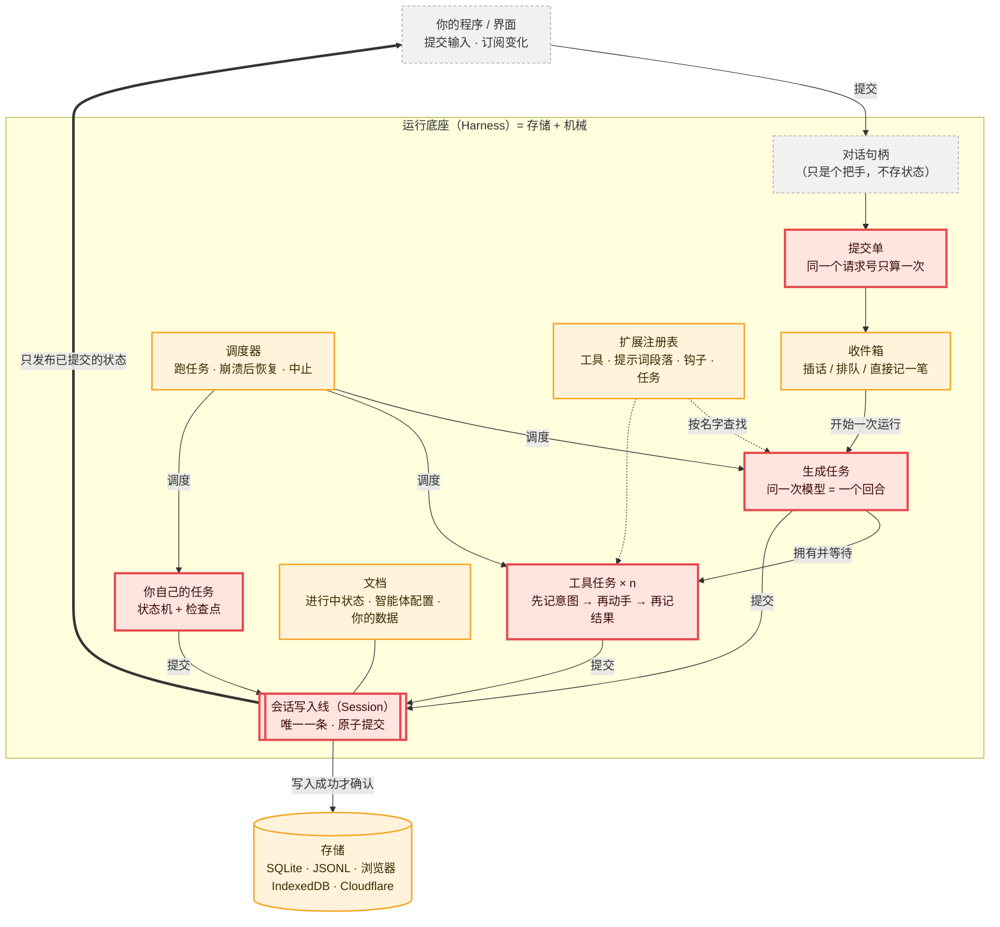
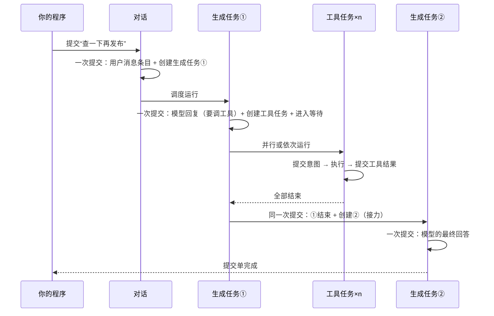

# 00 · 总览：一张图看懂 pi-durable

> **本课目标**：先建立全局地图，知道哪些是必须吃透的 🔴P0，哪些可以晚点学。
> **预计时间**：15 分钟　·　**前置**：会读 TypeScript；知道“大模型会调用工具”这件事。

## 1. 它是什么，解决什么问题

`@earendil-works/pi-durable`（本教程基于 v1.4.0）是 Earendil 公司开源的一个<strong>“断电也不丢”的 AI 智能体运行底座</strong>（英文叫 durable harness，“持久化运行底座”），代码在 [earendil-works/pi](https://github.com/earendil-works/pi/tree/136b87e8a7f5a3e5186de0289523ba327dc592fc/packages/durable) 仓库的 `packages/durable`。官方博客把它概括为：harness = **存储（storage）+ 机械（machinery）**，大约 1.5 万行代码。[^blog]

普通的智能体循环是这样的：

```text
while (true) { 问模型 → 模型说要调工具 → 调工具 → 把结果给模型 }
```

这个循环**只活在内存里**。进程一崩、机器一重启、浏览器标签一关，它就忘了自己做到哪一步：工具调到一半了没有？模型的回答收到了没有？用户刚发的那句话处理了没有？

pi-durable 的回答只有一句（它的规范 `docs/spec.md` 开篇的“核心规则”）：

> **一个会话（Session）以原子方式提交三样东西：不可变的记录条目、完整的任务记录、被追踪的文档。只有已经提交的状态，才能被看见。**[^spec]

整套设计都是从这句话长出来的。博客里列出的能力——在任何地方长时间运行、扛住崩溃、多个对话与分叉、扩展（段落/工具/钩子/任务）、上下文压缩、持久的应用状态、可热重载、多人协作——都是这条规则的推论。[^blog]

## 2. 架构总图（先看重点）

图例：<span class="p0">🔴 P0 必须吃透</span>　<span class="p1">🟠 P1 用到再深入</span>　<span class="p2">⚪ P2 进阶</span>



**读图的顺序**（也是本课程的顺序）：

1. 正中间那根粗线框：**会话的唯一一条写入线**。所有东西都从这里过。
2. 三个红框任务：生成任务、工具任务、你自己的任务。它们都是**带检查点的状态机**。
3. 工具任务里的**效果三明治**：先记意图 → 再动手 → 再记结果。
4. 左上的提交单：用户的话怎么“恰好一次”地进来。
5. 其余橙色/灰色部分，都是在这个骨架上加的功能。

## 3. 一次问答在库里留下了什么

官方说明文档用一张小图描述“一次被回答的输入”，翻译如下：[^readme]

```text
提交输入            → 写下「用户消息」条目（pi.user）
  生成任务           → 「系统提示」条目（pi.system，仅当提示词或工具变了）+「模型回复」条目（pi.assistant，里面带工具调用）
    工具任务 × n     → 「工具结果」条目 × n（pi.tool-result；工具任务归生成任务所有，它等它们全部结束）
  下一个生成任务     → 「模型回复」条目（最终回答）→ 提交单完成
```



## 4. 学习路线

| 顺序 | 课 | 主题 | 寓言 | 优先级 |
|---|---|---|---|---|
| 1 | [01](01-one-pen.md) | 唯一写入线与原子提交 | 米行里唯一的一支笔 | 🔴P0 |
| 2 | [02](02-task-checkpoint.md) | 任务 = 状态机 + 检查点 | 抄经的小和尚 | 🔴P0 |
| 3 | [03](03-effect-sandwich.md) | 效果三明治、“可安全重做” | 驿站的信使 | 🔴P0 |
| 4 | [04](04-submission.md) | 提交单与请求号（只算一次） | 挂号窗口 | 🔴P0 |
| 5 | [05](05-run-loop.md) | 一次回答：生成任务与工具任务的接力 | 面馆的接力单 | 🔴P0 |
| 6 | [06](06-context.md) | 取消令牌：不等了 ≠ 不做了 | 等外卖的人 | 🔴P0 |
| 7 | [07](07-documents.md) | 文档：和记录一起提交的状态 | 账本旁的小黑板 | 🟠P1 |
| 8 | [08](08-inbox.md) | 收件箱：插话 / 排队 / 直接记一笔 | 饭馆跑堂 | 🟠P1 |
| 9 | [09](09-extensions.md) | 扩展、注册表、热重载 | 戏单上的角色名 | 🟠P1 |
| 10 | [10](10-tools-hooks.md) | 工具、钩子、工具调工具 | 衙门口的门房 | 🟠P1 |
| 11 | [11](11-ownership-abort.md) | 归属树、自下而上地中止 | 马戏团拆帐篷 | 🟠P1 |
| 12 | [12](12-child-tasks.md) | 子任务：一败俱停 / 全部等完 | 分头买票 | 🟠P1 |
| 13 | [13](13-sleep-wake.md) | 睡眠、定时、唤醒 | 客栈的叫早牌 | 🟠P1 |
| 14 | [14](14-storage.md) | 存储约定与错误三原则 | 刻碑与告示 | 🟠P1 |
| 15 | [15](15-compaction.md) | 上下文压缩 | 船长的航海日志 | ⚪P2 |
| 16 | [16](16-forks.md) | 多个对话与分叉 | 棋谱上的岔路 | ⚪P2 |
| 17 | [17](17-watch.md) | 订阅变化、多人、晚到的人 | 茶馆说书 | ⚪P2 |
| 18 | [18](18-codemode.md) | 代码模式与“照日志重演” | 照着录音重演的木偶戏 | ⚪P2 |
| 19 | [19](19-crash-loop.md) | 崩溃循环与重启上限 | 总晕倒的搬运工 | ⚪P2 |
| 20 | [20](20-ts-unions.md) | 语法课：可辨识联合类型 | 邮局的分拣格 | 语法 |
| 21 | [21](21-ts-generics.md) | 语法课：泛型 | 糕点模具 | 语法 |
| 22 | [22](22-typebox.md) | 语法课：TypeBox 运行时类型 | 海关申报单 | 语法 |

> 💡 如果你只有一个下午：学完 01–06 就能读懂 pi-durable 80% 的代码。语法课 20–22 可以在任何一课遇到看不懂的语法时跳过去看。

## 5. 每一课怎么用

- **📜 寓言**：每个难懂的设计点都先讲一个小故事。故事里**不会出现技术名词**，读到快结尾时你会自己意识到它在讲什么。先别急着点“揭晓”，试着自己猜。
- **🔍 揭晓**：故事里的每个角色分别对应什么。
- **🧩 概念拆解**：把一个点拆成几小块，一块只讲一件事。
- **📄 源码**：贴最关键的几行，并附上固定版本（commit `136b87e`）的永久链接。
- **🧪 动手**：`labs/` 里每个脚本都在 Node 24 下真实跑过，课文里贴的输出就是真实输出。
- **🕹️ 模拟器**：网页版课程里可以点按钮“拔电源”，看系统怎么恢复。
- **🤔 思考题**：答案折叠着，想完再看。

## 6. 名词速查（中文叫法 ↔ 代码里的英文名）

本教程统一用左边的中文叫法；写代码时你会看到右边的英文名。

| 中文叫法 | 代码里的名字 | 一句话 |
|---|---|---|
| 运行底座 | `Harness` | 一个打开的存储 + 在上面跑智能体的全部机械 |
| 会话 / 写入线 | `Session` | 运行底座内部那条“唯一写入线”，负责原子提交 |
| 对话 | `Conversation` | 一份对话记录；手里拿的“对话句柄”本身不存状态 |
| 记录条目 | `Entry` | 一条写下就不再改的记录：用户消息、模型回复、工具结果、系统提示、重置、压缩摘要，或你自定义的种类 |
| 提交 | `commit` | 一次原子写入：要么全写进去，要么什么都没写 |
| 文档 | `Document` / `defineDoc` | 和记录放在一起、在提交里修改的 JSON 状态 |
| 任务 | `Task` / `defineTask` | 每走一步都存检查点的状态机 |
| 检查点 | `checkpoint` | 任务“下一步该干什么”的存档 |
| 提交单 | `Submission` | 交给对话的一件事（用户输入或要写的条目），可以等它完成 |
| 请求号 | `requestId` | 同一个请求号再交一次，拿回的还是原来那张提交单 |
| 回合 / 一次运行 | `turn` / `run` | 一次模型回复及其工具调用 / 从一个输入到最终回答的所有回合 |
| 扩展 / 注册表 | `Extension` / `Registry` | 一组工具、提示词段落、钩子、任务 / 本进程装了哪些扩展 |
| 钩子 | `hook` | 扩展在内置任务的关键点上“拦一下、改一下” |
| 取消令牌 | `Context`（来自 Chord 库） | 每个异步调用都带着它；取消它只取消“这次等待” |
| 插话 / 排队追问 / 直接记一笔 | `steer` / `followUp` / `write` | 对话正忙时，新消息的三种放法 |
| 可安全重做 | `replay: "safe"` | 工具声明：崩溃后重跑一遍也没有坏处 |

[^blog]: Earendil, *pi-durable*（2026-10-01）：<https://earendil.com/posts/pi-durable/>
[^spec]: 规范 `docs/spec.md` 开篇“核心规则”（英文原文：A Session atomically commits immutable entries, full task records, and Chord-tracked documents. Only committed state is observable.）：<https://github.com/earendil-works/pi/blob/136b87e8a7f5a3e5186de0289523ba327dc592fc/packages/durable/docs/spec.md>
[^readme]: 官方说明 `README.md` 的“概念”一节：<https://github.com/earendil-works/pi/blob/136b87e8a7f5a3e5186de0289523ba327dc592fc/packages/durable/README.md#concepts>
