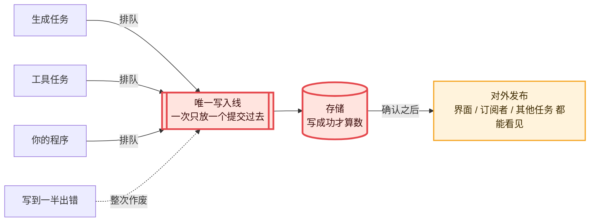

# 01 · 唯一的一支笔：写入线与原子提交　🔴P0

> **本课目标**
> 1. 说清楚“唯一一条写入线”是什么、为什么只要一条；
> 2. 会用 `commit()` 把“记录条目 + 文档 + 任务”一次性原子地写进去；
> 3. 记住全书最重要的一句话：**只有已提交的状态，才能被看见。**
>
> **预计时间**：25 分钟

## 1. 先看图



## 2. 寓言：米行里唯一的一支笔

> 📜 **寓言 · 米行里唯一的一支笔**
>
> 镇上有家老米行，十几个伙计：有人收米，有人发货，有人开欠条。掌柜立了两条怪规矩。
>
> 第一条：**整个米行只有一支笔**，就放在账房桌上。谁要记事，排队拿笔。而且一件事要一口气写完——“收王家米三石、开欠条一张、明日送货”这三样，必须在同一页上一次写完，写完盖上掌柜的章。写到一半有人喊你，宁可把这一页撕了重写，也不许留半页。
>
> 第二条：**伙计不许凭记性回答客人**。客人问“王家的米收了没有”，伙计得先翻账本。盖了章的才算数；没盖章的半页纸，字写得再工整，也当它不存在。
>
> 新来的小伙计嘀咕：十几个人抢一支笔，多慢啊！人手一支，各记各的，不好吗？
>
> 那年夏天，半夜发大水。伙计们蹚着水四散逃命。第二天水退了，米行里一片狼藉，米袋东倒西歪，谁也说不清昨晚自己干到了哪一步。
>
> 掌柜只做了一件事：从高柜顶上取下那本账，翻到最后一个盖章的地方。“从这儿接着干。” 再往后还有半页，写着“收李家米两石”，没有盖章。掌柜把它撕了：“这件事当没发生过，等李家来了重新收。”
>
> 隔壁米行是人手一个本子的。水退以后，他们的本子谁也对不上谁：甲的本子说王家的米收了，乙的本子说欠条还没开，丙的本子说货已经送出去了。三个伙计吵了三天，最后只好挨家挨户去问。
>
> 小伙计这才明白：那支笔慢，不是掌柜糊涂——**全米行只能有一个地方说了算，而它只认写完盖章的东西。**

<details>
<summary>🔍 揭晓：故事里的东西分别是什么？（先自己想一想再点开）</summary>

| 故事里 | pi-durable 里 |
|---|---|
| 米行 | 运行底座（`Harness`） |
| 唯一的一支笔 | 会话（`Session`）的**唯一一条写入线** |
| 一件事一口气写完，盖章 | 一次**原子提交**：记录条目、文档、任务一起写，要么全成，要么全不成 |
| 写到一半被喊走，撕掉重写 | 提交回调里抛错 → 整次提交回滚，什么也不留下 |
| 伙计只凭盖章的账本回答 | 界面、订阅者、其他任务都**只读已提交的状态** |
| 没盖章的半页当不存在 | 没提交成功的东西**不可见** |
| 发大水 | 进程崩溃、断电、机器被回收 |
| 翻到最后一个章，从那儿接着干 | 重新打开存储，从已提交的状态恢复 |
| 隔壁米行人手一本 | 内存变量、数据库、日志文件各记各的 → 崩溃后互相对不上 |

</details>

## 3. 概念拆解

### 3.1 一条写入线

规范第 1 节写得很直白：一个会话**拥有一条写入线**（mutation line），以及它名下的对话、记录、任务、提交单和文档。[^spec1]

“一条”的意思是：所有提交**排成一队，一次过一个**。这样每次提交都有一个先后分明的序号，不存在“两个提交交叉写了一半”的情况。代价是排队，好处是——崩溃之后，世界只有一个版本。

### 3.2 一次提交 = 一页盖了章的账

在代码里，“拿笔写一页”就是 `commit()`：

```ts
const RiceNote = defineEntry<string>("rice.note");   // 自定义一种记录条目（种类名不能以 pi. 开头）
// Todos 是一个文档（第 7 课），Deliver 是一个任务（第 2 课）

// 一次提交里：追加一条记录、改一个文档、创建一个任务。要么全写进去，要么都没写。
await root.commit(async (tx) => {
  await tx.appendEntry(RiceNote, root.id, { data: "王家米三石" });   // 记录条目
  (await tx.doc(Todos, root.id)).items.push("明日送货");          // 文档
  await tx.createTask(Deliver, { to: "王家" }, { ownership: { kind: "conversation" } }); // 任务
}, context);
```

> `tx` 是“这一页纸”（事务）。回调函数结束的那一刻，这页纸就收走了，之后再拿 `tx` 写字是无效的。[^spec1]

### 3.3 写到一半出错：整页作废

如果回调里抛了错，这次提交**什么都不会留下**。第 7 课的实验 `07-doc.ts` 演示了这件事：

```ts
await root.commit(async (tx) => {
  (await tx.doc(Todos, root.id)).items.push("洗碗");
  throw new Error("提交回调里抛错");   // “洗碗”不会出现在黑板上
}, context);
```

### 3.4 只有已提交的，才能被看见

规范列了 8 条必须遵守的不变式，前三条都在说同一件事：[^spec1]

1. 一次提交对所有记录和文档的写入是**原子的**；
2. 文档的变化**只在存储提交成功之后**才发布；
3. **所有可见的进展都已落盘**，没有“先在内存里给你看看”的通道。

连模型正在“一个字一个字往外蹦”的回答，也是先提交再显示的——默认每 100 毫秒提交一次，所以崩溃最多丢掉最后这 100 毫秒。[^readme-watch]

### 3.5 外部的事，不在这页纸上做

第 4 条不变式：**外部副作用不在提交事务里执行。** 写账本的时候不许顺手去仓库搬米——因为搬米这件事撕不掉。怎么安全地“又记账又搬米”，是第 3 课“效果三明治”的内容。

### 3.6 对话句柄只是个把手

`harness.root()` 拿到的 `Conversation` 对象**不存任何状态**，比较两个对话是不是同一个，要比 `id`。[^readme] 状态只在账本里——这和寓言里“不许凭记性”是一个意思。

## 4. 源码怎么写的

写入线的核心在 `session/session.ts` 的 `#runCommit`。删掉细节后，骨架是这样的（注释为本教程所加）：

```ts
const tx = new Transaction(this.#host, context, scope);   // 拿到一页纸
try {
  result = await change(tx);                              // 执行你的回调
} catch (error) {
  await tx.settleFailure();                               // 回调抛错 → 整页作废
  throw error;
}
writes = await tx.settleSuccess();                         // 收起这页纸，得到要写的内容
const adopt = (committed) => { adoption = { documents: tx.adopt(committed) }; };
seq = await this.#storage.commit(writes, adopt, withoutAbortSignal(context)); // 交给存储
//   ↑ 存储在“真正写稳”之后才调用 adopt(seq)，内存这时才接受这批变化
if (adoption === undefined) { this.fail(new Error("存储提交了却没有调用 adopt")); }
this.#publish(seq, writes, documents, context);            // 最后才对外发布
```

👉 源码位置：[`src/session/session.ts` 第 693 行附近](https://github.com/earendil-works/pi/blob/136b87e8a7f5a3e5186de0289523ba327dc592fc/packages/durable/src/session/session.ts#L693)

注意两个细节：

- `withoutAbortSignal(context)`：提交一旦交给存储，**调用方取消也打断不了它**（第 6 课细讲）。
- 先 `adopt` 后 `publish`：内存永远不会出现“半本账”。存储怎么配合这件事，第 14 课细讲。

## 5. 动手

```bash
cd labs && npm install
node 01-chat.ts
```

真实输出：

```text
same submission: true
answer: [{"type":"text","text":"巴黎。"}]
kinds: [ 'pi.user', 'pi.assistant' ]
```

最后一行列出了这次问答在账本里留下的记录条目：一条用户消息（`pi.user`），一条模型回复（`pi.assistant`）。第一行的 `true` 是第 4 课的内容。

<div class="sim" data-sim="commit">🕹️ 交互模拟器“原子提交”：请在网页版课程中打开（见仓库首页的说明）。</div>

## 6. 思考题

1. 为什么不让每个任务各写各的存储，再定期“对账”？
<details><summary>参考答案</summary>

各写各的，崩溃时就会出现“任务 A 写了、任务 B 没写”的中间状态，恢复代码要处理所有组合，几乎不可能写对。只有一条写入线、每次提交原子，崩溃后的世界就只有“某次提交之前”和“之后”两种，恢复逻辑才简单。

</details>

2. 界面上能不能“先乐观地显示，等写成功再确认”？
<details><summary>参考答案</summary>

pi-durable 刻意不这么做（不变式 3：没有不落盘的发布通道）。界面看到的就是已提交的状态，所以任何人——包括崩溃后重新打开的进程、晚加入的协作者——看到的都是同一个版本。代价是显示会晚一点点（默认最多 100 毫秒）。

</details>

## 小结

**一支笔，一页一页地写，盖了章才算数。** 后面所有的课，都是在讲“怎么在这条规矩下把事情做成”。

[^spec1]: 规范 §1 术语与不变式：<https://github.com/earendil-works/pi/blob/136b87e8a7f5a3e5186de0289523ba327dc592fc/packages/durable/docs/spec.md#1-terms-and-invariants>
[^readme-watch]: 官方说明“订阅一个对话”一节：<https://github.com/earendil-works/pi/blob/136b87e8a7f5a3e5186de0289523ba327dc592fc/packages/durable/README.md#watching-a-conversation>
[^readme]: 官方说明“概念”一节：<https://github.com/earendil-works/pi/blob/136b87e8a7f5a3e5186de0289523ba327dc592fc/packages/durable/README.md#concepts>
