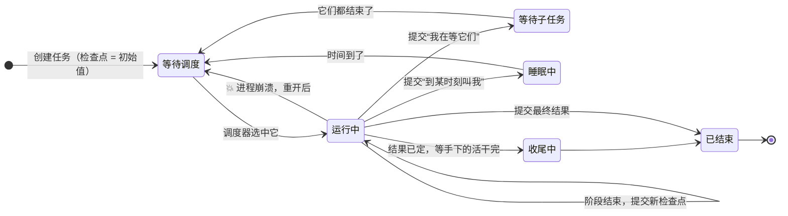

# 02 · 任务 = 状态机 + 检查点　🔴P0

> **本课目标**
> 1. 会用 `defineTask` 写一个能扛住崩溃的任务；
> 2. 理解“阶段（phase）”和“检查点（checkpoint）”：**每一步结束，都把“下一步做什么”提交下来**；
> 3. 知道崩溃后任务从哪里继续、哪些代码会被重跑。
>
> **预计时间**：30 分钟

## 1. 先看图



图里的状态对应代码里的 `pending`（等待调度）、`running`（运行中）、`waiting`（等待子任务）、`sleeping`（睡眠中）、`completing`（收尾中）、`terminal`（已结束）。已结束的任务有五种结局：`completed` 完成、`failed` 失败、`aborted` 被中止、`orphaned` 成了孤儿（定义找不到了）、`faulted` 出了故障（任务自己的代码出错）。[^types]

**本课最重要的一条红线**：🔴 *每个阶段都必须以一次“改变了状态”的提交结束。*

## 2. 寓言：抄经的小和尚

> 📜 **寓言 · 抄经的小和尚**
>
> 山寺里，老和尚交给小和尚一件活：抄一部五页的经，抄完装订成册。
>
> 寺里有块木牌挂在经堂门口。老和尚说：“每抄完一整页，就去把木牌翻到下一页的页码。抄完五页，把牌子翻到‘装订’。”
>
> 小和尚觉得多此一举：“我自己记得抄到哪儿了呀。”老和尚不解释，只又加了一条：“坐到经桌前的人，起身之前一定要翻牌。没翻牌就走，就当你没来过。”
>
> 那天夜里，小和尚抄到第三页的一半，山风吹灭了蜡烛。他摸黑回房睡了。第二天一早，山下来信，小和尚被派去化缘，一走就是半个月。
>
> 经书不能等。师兄被叫来接着抄。他从没见过这部经，也不知道小和尚抄到了哪里。他先看门口的木牌：“第三页”。再看经桌：第三页只抄了半张，墨迹还洇开了一块。
>
> 师兄没有费心去辨认那半张纸上哪一个字是最后写完的。他把它揉了，铺开一张新纸，**从第三页的第一个字抄起**。抄完第三页，翻牌“第四页”；抄完第五页，翻牌“装订”；装订完，摘下牌子。
>
> 过了几天，寺里又来了一个小沙弥。他在经桌前坐了一会儿，什么也没抄，起身走了，牌子没动。老和尚当场把他请出了经堂：“你坐了等于没坐。下一个人来，看到的还是这块牌，坐下、起身、再坐下……这部经要原地打转到哪年？”
>
> 半个月后小和尚回来，看见抄好的经书，一页不缺，一页不重。他这才懂了：**那块木牌不是给自己看的，是给“下一个不认识这部经的人”看的。**

<details>
<summary>🔍 揭晓：故事里的东西分别是什么？</summary>

| 故事里 | pi-durable 里 |
|---|---|
| 抄一部经 | 一个任务（`defineTask` 定义的持久状态机） |
| “抄第 N 页”“装订” | **阶段**（phase）：`copy`、`bind` |
| 门口的木牌 | **检查点**（checkpoint）：存进库里的 `{ phase: "copy", page: 3 }` |
| 抄完一整页才翻牌 | 阶段的最后一步：`runtime.commit(() => ({ status: "running", checkpoint: 下一步 }))` |
| 蜡烛灭了 | 进程崩溃 |
| 不认识这部经的师兄 | 重启后的新进程：内存里什么都没有，只有库里的检查点 |
| 半张纸揉掉，从第三页第一个字重抄 | 崩溃后，阶段**从头**重跑（检查点之后、提交之前做的事会重做） |
| 摘下牌子 | 提交最终结果：`{ status: "terminal", outcome: { status: "completed", ... } }` |
| 坐下又起身、不翻牌的小沙弥 | 阶段返回时**没有任何持久进展** → 调度器判它故障（`faulted`），防止原地空转 |

</details>

## 3. 概念拆解

### 3.1 一个任务长什么样

```ts
type 输入 = { pages: number };
type 状态 = { phase: "copy"; page: number } | { phase: "bind"; copied: number };   // 每种阶段带自己的数据

const CopySutra = defineTask<输入, 状态, string>({     // 三个类型参数：输入、状态、结果（第 21 课）
  name: "temple.copy-sutra",   // 任务种类名，存在库里；重启后靠它找回定义
  version: 1,                  // 定义版本；改了状态结构要升版本并写 migrate
  initial: () => ({ phase: "copy", page: 1 }),         // 第一个检查点
  phases: {
    copy: async (task, runtime, ctx) => { /* … */ },   // 每个阶段一个处理函数
    bind: async (task, runtime, ctx) => { /* … */ },
  },
  abort: (task, runtime, ctx) => /* 被中止时怎么收场，必须提交一个最终结果 */,
});
```

`phases` 必须**一个不漏**地覆盖状态里所有的 `phase` 名字，少写一个 TypeScript 就报错——这是靠类型 `readonly [P in S["phase"]]: …` 做到的（第 20、21 课细讲）。

### 3.2 阶段函数的三板斧

一个阶段函数只做三件事：

1. **读**：从 `task.state.checkpoint` 取出“我该干什么”；
2. **做**：干这一步的活；
3. **提交**：用 `runtime.commit()` 写下“下一步是什么”。

```ts
copy: async (task, runtime, ctx) => {
  const { page } = task.state.checkpoint;                       // ① 读木牌
  await 抄一页(page);                                            // ② 干活
  const next: 状态 = page < task.input.pages
    ? { phase: "copy", page: page + 1 }
    : { phase: "bind", copied: page };
  await runtime.commit(() => ({ status: "running", checkpoint: next }), ctx);   // ③ 翻牌
},
```

### 3.3 提交可以返回的几种“下一步”

| 返回值 | 意思 | 在哪课 |
|---|---|---|
| `{ status: "running", checkpoint }` | 换个检查点，马上接着跑 | 本课 |
| `{ status: "waiting", checkpoint, on, policy }` | 等这些任务结束再跑 | 第 12 课 |
| `{ status: "sleeping", until, checkpoint }` | 到某时刻再跑 | 第 13 课 |
| `{ status: "terminal", outcome }` | 结束，给出结局 | 本课 |

### 3.4 崩溃后，哪些代码会重跑？

记住一句话：**阶段从头重跑，检查点是唯一的记忆。**

- 在第 ③ 步提交**之前**崩溃：这一页会被重抄（第 ② 步再做一遍）；
- 在第 ③ 步提交**之后**崩溃：从下一页开始。

所以第 ② 步里如果有“撕不掉”的外部动作（扣款、发邮件、部署），就不能这么简单地写——这正是下一课“效果三明治”要解决的问题。

### 3.5 为什么“不翻牌就走”是故障

调度器在每个阶段返回后检查：检查点有没有变？源码里这条规则叫 **“没有持久进展”**：

```ts
// 6. no durable progress.（第 6 条：没有持久进展）
if (jsonEqual(current.state.checkpoint, previous.checkpoint)) {
  const message = `Task ${current.kind} phase ${previous.checkpoint.phase} returned without durable progress`;
  // → 这个任务被判为 faulted（故障）
```

👉 [`src/harness/scheduler.ts` 第 1842 行](https://github.com/earendil-works/pi/blob/136b87e8a7f5a3e5186de0289523ba327dc592fc/packages/durable/src/harness/scheduler.ts#L1842)

如果允许“不翻牌就走”，调度器会一次又一次地运行同一个阶段，永远在原地打转。

### 3.6 重启之后：运行中 → 等待调度

重新打开存储时，调度器的 `open()` 会把所有“运行中”的任务改回“等待调度”，并给它们的**重启次数 +1**（次数太多会被“停放”，见第 19 课）。

👉 [`src/harness/scheduler.ts` 第 382 行 `open()`](https://github.com/earendil-works/pi/blob/136b87e8a7f5a3e5186de0289523ba327dc592fc/packages/durable/src/harness/scheduler.ts#L382)

## 4. 动手：让任务在第 3 页“灭蜡烛”

完整代码见 [`labs/03-task.ts`](../labs/03-task.ts)。

```bash
node 03-task.ts first    # 第一次运行：抄到第 3 页时 process.exit(1)
node 03-task.ts second   # 第二次运行：重新打开同一个 SQLite 文件
```

真实输出：

```text
第一次运行
  ✍️  抄第 1 页
  ✍️  抄第 2 页
  ✍️  抄第 3 页
  💥 抄到一半，蜡烛灭了（进程崩溃）

第二次运行：存储里的检查点 = {"status":"pending","checkpoint":{"phase":"copy","page":3}}
  ✍️  抄第 3 页
  ✍️  抄第 4 页
  ✍️  抄第 5 页
  📚 装订 5 页
结果： {"status":"completed","result":"经书抄好了"}
```

注意第二次运行打印的检查点：状态是 `pending`（等待调度），不是崩溃前的 `running`——这就是 3.6 说的“改回等待调度”。

<div class="sim" data-sim="checkpoint">🕹️ 交互模拟器“抄经与灭蜡烛”：请在网页版课程中打开。</div>

## 5. 思考题

1. 如果把检查点设计成“抄到第几页的第几个字”，是不是能少重抄一点？为什么 pi-durable 的内置任务不这么做？
<details><summary>参考答案</summary>

可以，但每写一个字就要提交一次，写入线会被挤爆；而且“最后一个字到底写完没有”本身就说不清。检查点应该放在**天然的、可以从头重做的边界**上。需要细粒度进度时，用文档（第 7 课）按节奏提交，比如内置任务每 100 毫秒提交一次流式输出。

</details>

2. `abort` 处理函数为什么“必须提交一个最终结果”？
<details><summary>参考答案</summary>

中止也可能被崩溃打断。只有当 `abort` 提交了 `terminal` 结局，这个任务才算真正结束；否则重启后调度器会再次运行 `abort`（中止处理函数被打断太多次，任务以 `faulted` 结束）。

</details>

## 小结

**木牌是写给“下一个不认识这部经的人”看的。** 写任务时，永远假设下一行代码可能由另一个进程来执行。

[^types]: 任务状态与结局的类型定义：<https://github.com/earendil-works/pi/blob/136b87e8a7f5a3e5186de0289523ba327dc592fc/packages/durable/src/types.ts#L555>
