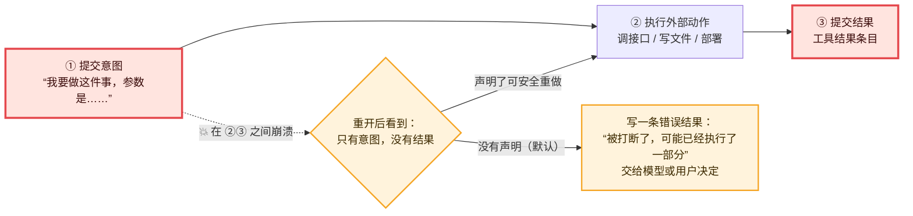

# 03 · 效果三明治：先记意图，再动手，再记结果　🔴P0

> **本课目标**
> 1. 记住规范里的“效果三明治”：**提交意图 → 执行外部动作 → 提交结果**；
> 2. 看懂工具任务的两个阶段 `call` 与 `execute`；
> 3. 会判断一个工具该不该声明 `replay: "safe"`（可安全重做）。
>
> **预计时间**：30 分钟　·　**前置**：第 01、02 课

## 1. 先看图



## 2. 寓言：驿站的信使

> 📜 **寓言 · 驿站的信使**
>
> 官道边有座驿站，驿丞手下有两个信使：阿福和阿禄。
>
> 驿站的差事分两种。一种是“去城门口抄告示”：告示就贴在那儿，抄一遍、抄十遍，抄回来都一样。另一种是“给将军送急信”：将军收到一封“敌军三千”，会派三千兵；要是收到两封，他会以为来了六千。
>
> 驿丞有个雷打不动的习惯：信使出门**之前**，先在簿子上写一行“某某出门，去做某事，带着什么”；信使回来**之后**，再写一行“某某回来了，事情如何”。信使们嫌他啰嗦——人还没走，写什么写。
>
> 这天一早，阿福揣着急信出门，阿禄去城门抄告示。午后暴雨，山路塌方，两人都没有回来。当晚驿丞也病倒了。
>
> 第二天，上面派来一位新驿丞。他谁也不认识，只能翻簿子。簿子最后写着两行“出门”，没有一行“回来”。
>
> 抄告示那件事，他想都没想，另派一个人去抄——多抄一遍又不会怎样。
>
> 送急信那件事，他拿起笔又放下。阿福可能半路就被冲走了，信根本没送到；也可能信已经送到，是回来的路上出的事。再派人送一封？将军可能收到两封，多派三千兵。不送？万一真没送到，前线就要吃亏。
>
> 新驿丞最后没有再派人。他在簿子上补了一行：“急信一封，可能已送出，也可能没有。不敢重送，请将军府回话确认。”然后把这一页抄给了上峰。
>
> 合上簿子，他出了一身冷汗：要是阿福出门前**没写那一行**，自己连“有一封急信可能在路上”这件事都不会知道——更谈不上去问了。

<details>
<summary>🔍 揭晓：故事里的东西分别是什么？</summary>

| 故事里 | pi-durable 里 |
|---|---|
| 信使出的一趟差 | 一次工具调用（一个工具任务） |
| 出门前写的那行 | ① **提交意图**：检查点 `{ phase: "execute", arguments, replay }` |
| 路上做的事 | ② **外部动作**：工具的 `execute()` 函数 |
| 回来后写的那行 | ③ **提交结果**：一条工具结果条目（`pi.tool-result`） |
| 抄告示（多抄无害） | 声明了 `replay: "safe"` 的工具，比如只读的搜索 |
| 送急信（重送有害） | 默认的工具（`replay` 不写就是 `"unsafe"`），比如部署、扣款、发邮件 |
| 暴雨塌方 | 进程在 ② 和 ③ 之间崩溃 |
| 新驿丞 | 重启后的进程，只能看库里的记录 |
| 另派一人再去抄 | 可安全重做的工具：**重跑** |
| “可能已送出，请回话确认” | 默认工具：写一条**错误结果**“被打断了，可能已经执行了一部分”，交给模型或用户 |
| 出门前没写那一行，就什么都不知道 | 如果意图没先提交，崩溃后连“有个动作可能做了一半”都无从得知 |

</details>

## 3. 概念拆解

### 3.1 规范原文（§5.2）

> 提交意图阶段 → 执行外部动作 → 提交结果或下一阶段。
> <strong>重开时处于“意图”阶段，就意味着外部动作可能已经发生了。</strong>阶段处理函数要么安全地重试，要么去外部查询一个句柄，要么记录“被打断”。[^spec52]

这三种出路，pi-durable 都用到了：

| 出路 | 谁在用 |
|---|---|
| 安全地重试 | 声明了 `replay: "safe"` 的工具 |
| 去外部查询句柄 | 生成任务调用“延迟返回”的模型时，把句柄存进 `poll`（轮询）阶段，重启后接着问 |
| 记录被打断 | 默认的工具：写一条 `interrupted`（被打断）错误结果 |

### 3.2 工具任务的两个阶段

每次模型要调一个工具，系统就创建一个工具任务。它只有两个阶段：

**`call` 阶段（正常路径）**：

1. 找到工具，校验参数；
2. 让钩子 `beforeTool` 过目（可以拦下或改参数，第 10 课）；
3. **提交意图**：把检查点改成 `{ phase: "execute", arguments: 最终参数, replay: 工具声明的策略 }`；
4. 运行工具的 `execute()`，结束后提交结果。

**`execute` 阶段（只在恢复时走到）**：正常情况下，任务在 `call` 阶段里就结束了，根本不会“走进” `execute` 阶段。只有在第 3 步之后崩溃，重启后调度器才会从检查点 `execute` 开始跑——这时它就是那位新驿丞。

### 3.3 源码：新驿丞的判断

```ts
/** 意图之后的恢复：只有“当时存下的策略”和“现在的定义”都说 safe，才重跑。 */
execute: async (task, runtime, context) => {
  const { arguments: args, replay } = task.state.checkpoint;           // 翻簿子
  const tool = await resolveTool(runtime, task.input, call.name, context);
  if (replay === "safe" && tool?.replay === "safe") {
    // 清掉上次跑了一半时发布的进度，从头再跑
    return run(runtime, task.input, call, tool, args, context);
  }
  const message = `Tool ${call.name} was interrupted and may have partially run`;
  //               “工具 X 被打断了，可能已经执行了一部分”
  await settle(runtime, task.input, call, { status: "failed", message }, …);
},
```

👉 [`src/harness/tool.ts` 第 135 行 `call`](https://github.com/earendil-works/pi/blob/136b87e8a7f5a3e5186de0289523ba327dc592fc/packages/durable/src/harness/tool.ts#L135)、[第 181 行 `execute`](https://github.com/earendil-works/pi/blob/136b87e8a7f5a3e5186de0289523ba327dc592fc/packages/durable/src/harness/tool.ts#L181)

两个值得琢磨的细节：

- **为什么要“两边都说 safe”？** 存下的策略代表“当时答应过可以重做”；现在的定义代表“现在的代码还认这个承诺”。热重载（第 9 课）可能把工具换成了不能重做的新版本，任何一边说不行就不重做。
- **为什么意图里要存 `arguments`？** 钩子可能改过参数。重做时必须用**当时真正要执行的那组参数**，而不是模型最初说的那组。

### 3.4 什么样的工具可以声明 `replay: "safe"`

| 可以 ✅ | 不可以 ❌（保持默认） |
|---|---|
| 只读：搜索、读文件、查询 | 扣款、下单、发消息、发邮件 |
| 结果只取决于参数，重复执行结果一样 | 部署、迁移数据库、删除东西 |
| 自己带“幂等键”的写操作（同一个键只生效一次） | 没有幂等保护的写操作 |

> 💡 拿不准就别声明。默认的“被打断”结果最多让模型多问一句；错误的 `safe` 可能让你扣两次钱。

想让有副作用的动作也能安全重做，就给它一个**幂等键**：第 12 课的付款任务用 `payment-${task.id}` 作为键，银行看到同一个键只扣一次。任务 ID 在崩溃前后不变，所以重跑时键也不变。

## 4. 动手

### 4.1 真实的 pi-durable：一个可重做、一个不可重做

[`labs/02-crash.ts`](../labs/02-crash.ts) 让模型同时调用 `search`（`replay: "safe"`）和 `deploy`（默认），并在 `search` 执行到一半时“拔电源”。

```bash
node 02-crash.ts first    # 💥 search 执行到一半，进程崩溃
node 02-crash.ts second   # 重开同一个库，继续
```

第二次运行的真实输出（中文注释为本教程所加）：

```text
submission: done
  pi.user                                       ← 用户：“查一下再发布”
  pi.system
  pi.assistant     [call search][call deploy]   ← 模型：要调这两个工具
  pi.tool-result   deploy ❌ [error] Tool deploy was interrupted and may have partially run
                                                ← deploy 不可重做：记为“被打断，可能已执行了一部分”
  pi.tool-result   search ✅ found 3 results for flaky test
                                                ← search 可重做：重跑成功
  pi.assistant     search 重跑成功；deploy 被中断，我不会自动重发，请确认后再部署。
```

### 4.2 70 行玩具版：自己实现一遍

[`labs/10-mini-durable.ts`](../labs/10-mini-durable.ts) 不依赖任何库，用一个日志文件实现了“唯一写入线 + 检查点 + 效果三明治”：

```bash
node 10-mini-durable.ts crash   # 做到“放盐”时停电
node 10-mini-durable.ts         # 恢复
```

```text
恢复：第 1 步「放盐」只有意图没有结果
  → replay=unsafe，不重做，记为 interrupted
跳过第 0 步「搅拌」：搅匀了
跳过第 1 步「放盐」：⚠️ 可能做过了，等人确认
做第 2 步「尝味」：咸淡正好
```

<div class="sim" data-sim="sandwich">🕹️ 交互模拟器“放盐还是搅拌”：请在网页版课程中打开。</div>

## 5. 思考题

1. 如果把顺序改成“先执行，再一次性提交意图和结果”，会出什么问题？
<details><summary>参考答案</summary>

执行完、提交前崩溃的话，库里**什么痕迹都没有**。重启后系统以为这个工具从没跑过，会再跑一遍——对部署、扣款这类动作就是重复执行，而且没人知道。先记意图，至少保证“可能做过”这件事被知道。

</details>

2. `search` 声明了 `replay: "safe"`，但它内部调用了 `deploy`（工具调工具，第 10 课）。崩溃后会怎样？
<details><summary>参考答案</summary>

`search` 会重跑；它按同样顺序再调用 `deploy` 时，会拿回之前那次嵌套调用（按“键”重新挂上）。如果那次 `deploy` 自己也被崩溃打断了，就按 `deploy` 自己的策略处理——它没声明 safe，所以得到“被打断”的错误结果。官方说明特别提醒：**可重做的工具如果有外部副作用，仍然需要自己的幂等保护。**[^nested]

</details>

## 小结

**先记一笔，再动手。** 崩溃不可怕，可怕的是不知道自己做没做过。

[^spec52]: 规范 §5.2 效果三明治：<https://github.com/earendil-works/pi/blob/136b87e8a7f5a3e5186de0289523ba327dc592fc/packages/durable/docs/spec.md#52-effect-sandwich>
[^nested]: 官方说明“工具调工具”一节：<https://github.com/earendil-works/pi/blob/136b87e8a7f5a3e5186de0289523ba327dc592fc/packages/durable/README.md#calling-tools-from-tools>
