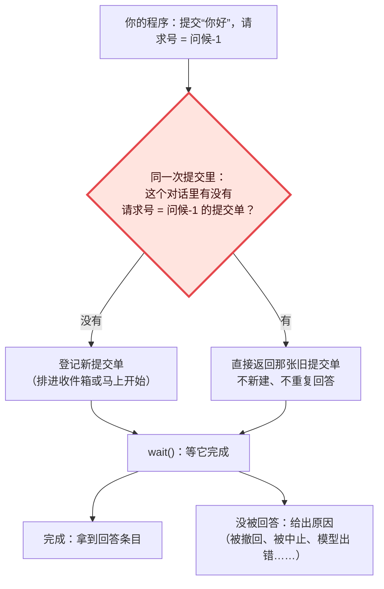

# 04 · 提交单与请求号：同一件事只算一次　🔴P0

> **本课目标**
> 1. 知道“提交单”（Submission）是什么，怎么等它完成；
> 2. 会用请求号 `requestId` 让“网络重试”“崩溃后重发”不会把一句话提交两次；
> 3. 理解为什么“查重”和“登记”必须在**同一次提交**里完成。
>
> **预计时间**：20 分钟

## 1. 先看图



## 2. 寓言：挂号窗口

> 📜 **寓言 · 挂号窗口**
>
> 老李去城里的大医院看病。出门前，儿子塞给他一张小纸条，上面写着一串字：“李-0312-复诊”。“爸，挂号的时候把这张条子一起递进去。”老李不知道这有什么用，揣进了兜里。
>
> 挂号的人排成长龙。轮到老李，他把钱和纸条递进窗口。窗口里的护士刚敲完键盘，大厅突然停电，人群一挤，老李被挤出了队伍。挂号单没拿到，钱也交了。挂上没有？他不知道。
>
> 他只好重新排队。前面一个大爷在嚷嚷：他上周在别家医院遇到一样的事，重新排了一次，结果挂了两个号、交了两份钱，医生还叫了他两遍。
>
> 老李心里打鼓。又轮到他了，护士接过纸条，看了一眼，在电脑上一查：“李-0312-复诊——上午已经挂过了。这是您的单子，三号诊室，第七位。”没有再收钱，也没有新的号。
>
> 老李拿着单子去诊室门口等。等着等着，他想起车还停在路边，就先出去挪车了。回来时，护士看看他的单子：“还没叫到您，接着等吧。”——挪车并没有让他的号作废。
>
> 看完病回家，老李跟儿子说起这事。儿子笑了：“窗口不认人脸，也不管您排了几次队。它只认那张条子上的字：同一串字，只挂一次号。”

<details>
<summary>🔍 揭晓：故事里的东西分别是什么？</summary>

| 故事里 | pi-durable 里 |
|---|---|
| 挂号 | `conversation.submit(...)`：把一件事交给对话 |
| 挂号单 | 提交单（`Submission`），有自己的 `id` |
| 儿子写的纸条“李-0312-复诊” | **请求号** `requestId`：由**调用方自己**定，代表“这一件事” |
| 停电、被挤出队伍 | 网络超时、进程崩溃，调用方不知道提交成功没有 |
| 重新排队 | 用**同一个请求号**再提交一次 |
| “上午已经挂过了，这是您的单子” | 返回已存在的那张提交单，不重复登记 |
| 别家医院挂了两个号 | 没有请求号的系统：重试 = 重复提交，模型回答两遍 |
| 在诊室门口等 | `submission.wait(context)` |
| 出去挪车，号不作废 | 取消“等待”不会撤销提交单（第 6 课）；之后可用 `harness.submission(id)` 找回它接着等 |

</details>

## 3. 概念拆解

### 3.1 提交单有两种

```ts
// ① 用户输入：会让模型回答
await root.submit({ type: "input", content: "你好", requestId: "问候-1" }, context);
// ② 直接写一条记录：不问模型
await root.submit({ type: "write", entry: { kind: "app.note", data: "用户打开了一个文件" } }, context);
```

对话忙的时候，提交单会进收件箱排队——插话、排队追问这些放法是第 8 课的内容。

### 3.2 等它完成

```ts
const submission = await root.submit({ type: "input", content: "法国首都是？", requestId: "q-1" }, context);
const settled = await submission.wait(context);
if (settled.status === "done") {
  // settled.answer 是回答那条记录条目的 id
} else {
  // settled.status === "unanswered"，settled.reason 说明原因
}
```

结局只有两种（类型定义见 [`src/types.ts` 第 543 行](https://github.com/earendil-works/pi/blob/136b87e8a7f5a3e5186de0289523ba327dc592fc/packages/durable/src/types.ts#L543)）：

| 结局 | 含义 |
|---|---|
| `done` + `answer` | 回答好了，`answer` 是回答条目的 id |
| `unanswered` + `reason` | 没有回答，比如被撤回、被中止、模型出错（`model_error`）、被重置 |

### 3.3 请求号：查重和登记在同一次提交里

```ts
// src/harness/submissions.ts，登记一张提交单时（注释为本教程所加）
if (draft.requestId !== undefined) {
  const existing = await tx.submissionByRequest(conversationId, draft.requestId);   // 在同一个事务 tx 里查
  if (existing !== undefined) {
    if (existing.type !== draft.type) throw new Error(`请求号 ${draft.requestId} 已经被另一种提交单用过了`);
    return { id: existing.id, status: … };                                         // 找到了：直接还给你
  }
}
// 没找到：在同一个 tx 里登记新的提交单
```

👉 [`src/harness/submissions.ts` 第 210 行](https://github.com/earendil-works/pi/blob/136b87e8a7f5a3e5186de0289523ba327dc592fc/packages/durable/src/harness/submissions.ts#L210)

为什么一定要在**同一个事务**里？如果先查、再另起一次提交去登记，两次重试可能同时查到“没有”，然后各登记一张——又挂了两个号。放在同一个事务里，加上第 1 课的“唯一写入线”，查重和登记就是不可分割的一步。

还有两个细节：

- 请求号的作用范围是**一个对话**：不同对话里可以用同一个请求号。
- 请求号由**调用方**决定。好的请求号来自“这件事本身”，比如聊天消息的 id、前端生成的 UUID、`subagent:${任务id}`——这样重启后重新算一遍，得到的还是同一个号。

### 3.4 崩溃后找回提交单

```ts
const again = await root.submit({ type: "input", content: "你好", requestId: "问候-1" }, context); // 方法一：同号重交
const same = await harness.submission(submissionId, context);                                  // 方法二：按 id 找回
```

官方说明在讲错误处理时也用到了这一点：存储出错时整个运行底座会关闭，**重新打开、用同一个请求号再交一次**，就能找到已经登记过的那张提交单。[^errors]

## 4. 动手

[`labs/01-chat.ts`](../labs/01-chat.ts) 用同一个请求号提交了两次：

```ts
const submission = await root.submit({ type: "input", content: "法国首都是？", requestId: "q-1" }, context);
const again      = await root.submit({ type: "input", content: "法国首都是？", requestId: "q-1" }, context);
console.log("same submission:", submission.id === again.id);
```

真实输出：

```text
same submission: true          ← 是同一张提交单
answer: [{"type":"text","text":"巴黎。"}]
kinds: [ 'pi.user', 'pi.assistant' ]   ← 只有一条用户消息、一条回答，没有重复
```

<div class="sim" data-sim="submit">🕹️ 交互模拟器“挂号窗口”：请在网页版课程中打开。</div>

## 5. 思考题

1. 用 `Date.now()` 做请求号好不好？
<details><summary>参考答案</summary>

不好。重试时时间变了，请求号也变了，查重就失效了。请求号必须是“重算也不变”的东西：消息 id、业务单号、或者在第一次发送前就生成并保存好的 UUID。

</details>

2. 第 12 课的付款任务用 `payment-${task.id}` 做银行的幂等键，和请求号是不是一个思路？
<details><summary>参考答案</summary>

是同一个思路，只是方向相反：请求号让**外面的人**重复提交时 pi-durable 只算一次；幂等键让 **pi-durable 自己**重复调用外部系统时，外部系统只算一次。两头都靠一个“重算也不变”的编号。

</details>

## 小结

**窗口不认人脸，只认纸条上的字。** 任何可能重试的提交，都带上请求号。

[^errors]: 官方说明“错误”一节第 1 条：<https://github.com/earendil-works/pi/blob/136b87e8a7f5a3e5186de0289523ba327dc592fc/packages/durable/README.md#errors>
