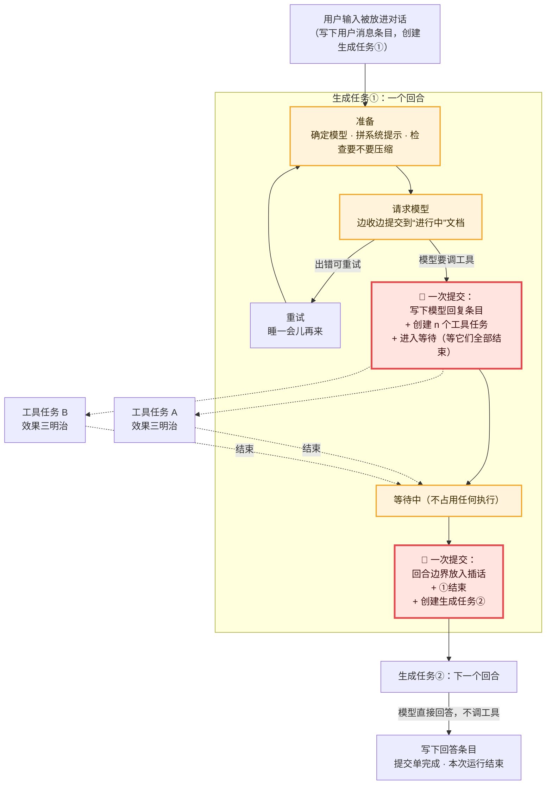

# 05 · 一次回答的全过程：生成任务与工具任务的接力　🔴P0

> **本课目标**
> 1. 分清“回合”（turn）和“一次运行”（run）；
> 2. 看懂生成任务（`pi.generation`）的几个阶段；
> 3. 理解最关键的两次提交：**“模型回复 + 工具任务 + 进入等待”一次写下**，**“本回合结束 + 创建下一个生成任务”一次写下**。
>
> **预计时间**：30 分钟　·　**前置**：第 01–04 课

## 1. 先看图



## 2. 寓言：面馆的接力单

> 📜 **寓言 · 面馆的接力单**
>
> 城南有家面馆，规矩和别家不一样：**没有哪个跑堂从头到尾管一桌客人。**
>
> 一桌客人点了“一碗好吃的面”。跑堂小甲接过单子，琢磨了一下：这一轮得先让厨房做两样——熬浇头、下面条。他在大本子上**一笔写下三件事**：“我决定做浇头和面条”“给浇头师傅、面条师傅各开一张分单”“我在等这两张分单”。写完，他就靠着柜台歇着，什么也不干，只等。
>
> 两位师傅各做各的，做好了，各自在分单上写“好了”。
>
> 两张分单都回来了。小甲又在本子上**一笔写下**：“我这一轮完了”“开一张新的接力单，交给下一个跑堂”。写完，他就下班了。
>
> 这时客人喊了一句：“少放辣！”掌柜没有冲进厨房，而是把这句话**夹进本子里两轮之间的那一页**。
>
> 跑堂小乙拿起新的接力单，翻开本子：浇头好了，面条好了，中间还夹着一句“少放辣”。他想了想，这一轮不用再做什么了，只要按客人说的调一下味，就能上桌。他写下“上桌”——这桌客人的事办完了。
>
> 新来的学徒问掌柜：“一个人从头管到尾不是更省事吗？”掌柜指了指墙角：“上个月小丙管一桌管到一半，中暑晕倒了。要是他脑子里记着一整桌的事，那桌菜就全乱了。可在我们这儿，他晕倒了也不打紧——**每个人只管一轮，每次交接都写在本子上**。下一个人翻开本子，就知道从哪儿接。”

<details>
<summary>🔍 揭晓：故事里的东西分别是什么？</summary>

| 故事里 | pi-durable 里 |
|---|---|
| 一桌客人的单子 | 一次运行（run）：从一个输入到最终回答 |
| 一个跑堂管的“一轮” | 一个回合（turn）= 一个生成任务（`pi.generation`） |
| 琢磨这一轮做什么 | 请求模型，模型回复里带着工具调用 |
| 一笔写下三件事 | **一次提交**：模型回复条目 + 创建工具任务 + 状态改为“等待” |
| 靠着柜台只等 | `waiting`：等待中的任务不运行任何代码 |
| 两位师傅、两张分单 | 两个工具任务（`pi.tool`），归这个生成任务所有 |
| “我这一轮完了” + 新接力单，一笔写下 | **一次提交**：本生成任务结束 + 创建下一个生成任务 |
| 夹在两轮之间的“少放辣” | 插话（steer）：放在“工具回合之后”的边界上（第 8 课） |
| 小乙写下“上桌” | 模型直接回答 → 回答条目 → 提交单完成 |
| 中暑晕倒的小丙 | 崩溃的进程：因为每轮交接都已提交，下一个进程照着本子接着干 |

</details>

## 3. 概念拆解

### 3.1 回合与一次运行

- **回合**（turn）：一次模型回复，以及它发起的工具调用。
- **一次运行**（run）：从一个被接纳的输入，到最终回答之间的所有回合。运行进行中，对话就是“忙”的。[^spec1]

在 pi-durable 里，**一个回合就是一个生成任务**。一次运行通常由好几个生成任务接力完成。

### 3.2 生成任务的阶段

```ts
// src/harness/generation.ts 里的检查点类型（节选，注释为本教程所加）
| { phase: "prepare"; attempt; … }                 // 准备：确定模型、拼系统提示、检查是否需要先压缩
| { phase: "request"; attempt; model; … }          // 请求模型：边收边把部分回答提交到“进行中”文档
| { phase: "retry"; attempt; until; … }            // 重试：睡到 until 再回到 prepare
| { phase: "poll"; handle; … }                     // 轮询：模型是“延迟返回”的，存下句柄，定时去问
| { phase: "tools"; assistant; tools; pending }    // 工具：等工具任务结束
```

👉 [`prepare` 第 133 行](https://github.com/earendil-works/pi/blob/136b87e8a7f5a3e5186de0289523ba327dc592fc/packages/durable/src/harness/generation.ts#L133)、[`request` 第 209 行](https://github.com/earendil-works/pi/blob/136b87e8a7f5a3e5186de0289523ba327dc592fc/packages/durable/src/harness/generation.ts#L209)、[`tools` 第 264 行](https://github.com/earendil-works/pi/blob/136b87e8a7f5a3e5186de0289523ba327dc592fc/packages/durable/src/harness/generation.ts#L264)

注意 `retry` 和 `poll`：重试的退避、轮询的间隔，都是**提交下来的睡眠**（第 13 课），所以就算在等待重试时崩溃，重启后也知道该在什么时候重试。

### 3.3 关键提交 ①：模型回复 + 工具任务 + 等待

模型回复里带着工具调用时，生成任务在**一次提交**里做完这些事：

```ts
await runtime.commit(async (tx) => {
  const entry = await appendAssistant(tx, conversationId, message);   // 写下模型回复条目（顺便记用量）
  for (const call of calls) {
    if (!offered.has(call.name)) { /* 模型调了不存在的工具：直接写一条错误结果 */ continue; }
    const taskId = await createToolTask(tx, runtime, entry.id, call.id); // 每个调用一个工具任务
    tools.push(taskId);
  }
  live.tools = slots;                                                  // 更新“进行中”文档，界面能看到
  return { status: "waiting", checkpoint: { phase: "tools", assistant: entry.id, tools, pending },
           on: tools, policy: "allSettled" };                          // 等它们全部结束
}, context);
```

为什么非得一次提交？想象分成两次：先写模型回复，再创建工具任务。如果在两次之间崩溃，库里就有一条“我要调工具”的回复，却没有任何工具任务——没人会去执行它，也没人会写结果，对话永远卡住。**一次提交，就不存在这个缝。**

### 3.4 并行还是依次

默认设置 `toolExecution: "parallel"`：一个回合的工具同时跑。设成 `"sequential"`，或者某个被调用的工具自己声明了 `executionMode: "sequential"`，整个回合就改为依次执行——`pending` 里放着还没开始的调用，`tools` 阶段每次启动一个、等它结束再启动下一个。

### 3.5 关键提交 ②：交接棒

工具全部结束后，`finishToolRound` 在**一次提交**里：

1. 在“工具回合之后”的边界上放入排队的插话（第 8 课）；
2. 处理工具结果里的控制信号：全部工具都要求 `terminate`（结束）→ 本次运行结束；有 `handoff`（交接）→ 写一条重置条目开始新上下文；
3. 否则：**创建下一个生成任务**，把“当前运行”交给它（源码里叫 `handOver`，交接）；
4. 自己以“完成”结束。

```ts
handOver(live, runtime.taskId, await createGeneration(tx, conversationId));
return { status: "terminal", outcome: { status: "completed", result: { entryId: assistant } } };
```

👉 [`src/harness/generation.ts` 第 732 行附近](https://github.com/earendil-works/pi/blob/136b87e8a7f5a3e5186de0289523ba327dc592fc/packages/durable/src/harness/generation.ts#L732)

### 3.6 什么时候结束

模型的回复**不再调用工具**时，这就是最终回答：写下回答条目，提交单变为 `done`。在这之前，钩子 `onYield` 还有一次机会说“继续干”（第 10 课）。

## 4. 动手

[`labs/05-inbox.ts`](../labs/05-inbox.ts) 打印了一次带工具调用的运行在库里留下的全部条目：

```text
  pi.user         来一份宫保鸡丁            ← 用户输入
  pi.system                                 ← 系统提示（第一次请求前写下）
  pi.assistant    [call cook]               ← 生成任务①：要调用 cook 工具
  pi.tool-result  宫保鸡丁 做好了            ← 工具任务的结果
  pi.user         少放辣！                  ← 插话：放在工具回合之后
  pi.assistant    宫保鸡丁上桌，已按要求少放辣。  ← 生成任务②：最终回答
  pi.user         再来碗米饭                ← 排队追问：开始下一次运行
  pi.assistant    米饭马上来。
```

## 5. 思考题

1. 为什么不让一个生成任务用循环管完整次运行，而要每个回合换一个任务？
<details><summary>参考答案</summary>

每个任务的检查点只需描述“这一个回合”，结构简单；回合之间的交接是一次原子提交，恢复时只需看当前是哪个生成任务、在哪个阶段。另外，任务的每个阶段开始时都会重新从注册表解析智能体配置和钩子（第 9 课），换了新代码的扩展从下一个阶段、下一次请求起就生效。

</details>

2. 模型一次调用了 3 个工具，其中 1 个在执行中崩溃了。重启后会发生什么？
<details><summary>参考答案</summary>

生成任务仍在等待（它的检查点就是“等这 3 个工具任务”）。已结束的 2 个不受影响；崩溃的那个按效果三明治处理：可安全重做就重跑，否则写“被打断”的错误结果。3 个都结束后，生成任务照常交接给下一个回合——模型会看到这条错误结果。

</details>

## 小结

**每个人只管一轮，每次交接都写在本子上。** 记住两次关键提交：“回复 + 工具任务 + 等待”和“结束 + 下一个生成任务”。

[^spec1]: 规范 §1 对回合与运行的定义：<https://github.com/earendil-works/pi/blob/136b87e8a7f5a3e5186de0289523ba327dc592fc/packages/durable/docs/spec.md#1-terms-and-invariants>
