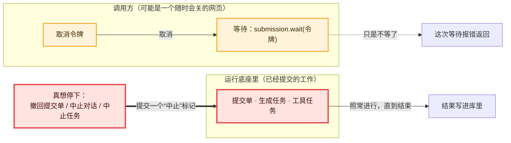

# 06 · 取消令牌：不等了 ≠ 不做了　🔴P0

> **本课目标**
> 1. 知道 pi-durable 里每个异步调用最后那个 `context` 参数是什么；
> 2. 记住一条规矩：**取消“等待”，永远不会取消“工作”**；
> 3. 知道真想停下工作时，该调用哪些方法。
>
> **预计时间**：20 分钟

## 1. 先看图



## 2. 寓言：等外卖的人

> 📜 **寓言 · 等外卖的人**
>
> 小周在手机上点了一份牛肉面。付完钱，他就盯着屏幕上那个转圈的小图标。
>
> 转了二十分钟，他饿得心慌，烦了。屏幕右上角有个按钮，他点了下去，页面关上，屏幕黑了。他揣上钥匙，下楼去买煎饼。
>
> 可是那家面馆的后厨——锅照样开着火，面照样下锅，骑手照样把面挂上车把，出了门。
>
> 小周在楼下刚咬了一口煎饼，就看见骑手停在单元门口，喊着他的名字。
>
> 他愣了一下：我不是点了按钮吗？
>
> 他重新打开手机，这才看清：刚才那个按钮写的是“**不再等待**”，旁边灰色的小字是“关闭本页面，订单照常配送”。真正能让厨房停火的，是订单页最下面另一个红色的按钮：“**取消订单**”。点了它，厨房会收到通知，按自己的规矩收场——还没下锅的就不做了，已经出锅的就作废、退钱。
>
> 小周拎着面上楼，想起上回手机半路没电的事：那次他以为订单肯定泡汤了，结果面照样送到。<strong>屏幕关了，订单还在；他不看了，面照样做。</strong>原来“我在等”和“它在做”，从头到尾就是两件事。

<details>
<summary>🔍 揭晓：故事里的东西分别是什么？</summary>

| 故事里 | pi-durable 里 |
|---|---|
| 盯着屏幕等 | `await submission.wait(context)`、`harness.waitForTask(id, context)` |
| “不再等待”按钮 | 取消调用方的取消令牌（Chord 库的 `Context`），比如 `withCancel(context).cancel()` |
| 页面关上 | 这次等待报错返回 |
| 后厨照样做、骑手照样送 | 已提交的工作（提交单、任务）**照常运行到结束** |
| “取消订单”按钮 | `submission.abort()`、`conversation.abort()`、`harness.abortTask(id)`：**提交一个中止标记** |
| 厨房按自己的规矩收场 | 被中止的任务运行自己的 `abort` 处理函数（第 2、11 课） |
| 手机没电，订单照样送到 | 调用方进程退出，已提交的工作不受影响；提交一旦交给存储，调用方取消也打断不了它 |

</details>

## 3. 概念拆解

### 3.1 每个异步调用都带一个令牌

pi-durable 的每个异步方法，最后一个参数都是 `context`。它来自 Chord 库（`@earendil-works/chord/context`），里面装着两样东西：**取消信号**和**追踪信息**（telemetry span）。[^readme]

```ts
import { BACKGROUND_CONTEXT, withCancel } from "@earendil-works/chord/context";

const context = BACKGROUND_CONTEXT;           // 永不取消的令牌，追踪为空操作
const { context: 可取消的, cancel } = withCancel(context);   // 派生一个可以单独取消的子令牌
```

为什么不直接用全局变量或者 `AbortSignal`？因为令牌是**显式传递**的：谁调用、谁传、谁取消，一目了然；子令牌被取消，不会影响父令牌。

### 3.2 规矩：取消只取消“这一次调用或等待”

官方说明原话：**“取消一次等待，只取消那次等待，从不取消工作。”** 规范里说得更细：取消某个调用方的令牌，只取消那次调用或等待；**除非你调用的接口提交了一个中止标记**，否则不会持久地中止共享的工作。[^spec54]

为什么这么设计？因为持久的工作**不属于任何一个调用方**：

- 调用方可能是一个浏览器标签，用户随时会关掉它；
- 好几个界面可能在等同一个提交单（第 17 课的多人协作）；
- 调用方进程可能崩溃，而工作要在另一个进程里接着跑。

如果某个等待者一取消，工作就跟着停，这些场景全都会乱套。

### 3.3 真想停下，用这些

| 想做的事 | 用法 |
|---|---|
| 撤回一个还在排队的提交单 | `await submission.abort(context)` |
| 停下整个对话当前的工作 | `await root.abort(context)`（排队的输入被撤回，排队的“记一笔”保留） |
| 连后台工作也一起停 | `await root.abort(context, { background: true })` |
| 中止某个任务 | `await harness.abortTask(id, context)` |

这些方法都会**提交一个中止标记**，然后由调度器让相关任务运行各自的 `abort` 处理函数，自下而上地收场（第 11 课）。

### 3.4 底座内部也守这个规矩

第 1 课的提交源码里有一行：

```ts
// 一旦被接纳，调用方的取消就不会打断存储的落盘。
seq = await this.#storage.commit(writes, adopt, withoutAbortSignal(context));
```

`withoutAbortSignal` 派生一个“保留其他信息、只去掉取消信号”的令牌。提交交给存储之后，就算调用方取消了，这次写入也会完整地落盘或完整地失败，绝不会写一半。

### 3.5 反过来：任务代码要听自己的信号

任务运行时有 `runtime.signal`。当任务被中止、或运行底座关闭时，这个信号会触发。任务里发起的网络请求、子进程，应该把它传下去。官方说明提醒：关闭底座会**等正在运行的任务代码返回**，所以无视中止信号的代码会拖慢关闭。[^errors]

## 4. 动手

[`labs/06-context.ts`](../labs/06-context.ts)：点一碗慢炖的汤（工具要跑 500 毫秒），100 毫秒后取消等待。

```ts
const order = await root.submit({ type: "input", content: "来碗汤" }, context);
const impatient = withCancel(context);
setTimeout(() => impatient.cancel(new Error("不等了")), 100);
try { await order.wait(impatient.context); } catch (e) { console.log("等待被取消：", e.message); }
const settled = await order.wait(context);    // 换一个不会取消的令牌再等一次
```

真实输出：

```text
  🙅 等待被取消： 不等了
  🍲 汤炖好了（工具照常跑完）
  ✅ 提交最终状态： done
```

## 5. 思考题

1. 用户在网页上点了“停止生成”。你应该取消前端那次 `wait()` 的令牌，还是调用 `root.abort()`？
<details><summary>参考答案</summary>

调用 `root.abort()`。取消令牌只会让前端不再等，模型和工具会继续跑、继续花钱。“停止生成”是要停下工作，必须提交中止标记。

</details>

2. 一个工具里调用了 `api.executeTool("bash", …, context)`，然后取消了这个 `context`，`bash` 会停吗？
<details><summary>参考答案</summary>

不会。官方说明明确写了：取消 `executeTool()` 的令牌只停止等待。嵌套调用会在调用它的工具结束前被中止（调用方结束时，留下的嵌套调用会被清理），或者在调用方本身被中止时一并中止。[^nested]

</details>

## 小结

**“我在等”和“它在做”是两件事。** 关掉屏幕用取消令牌；让厨房停火，要提交中止。

[^readme]: 官方说明“快速开始”一节对令牌的说明：<https://github.com/earendil-works/pi/blob/136b87e8a7f5a3e5186de0289523ba327dc592fc/packages/durable/README.md#quick-start>
[^spec54]: 规范 §5.4 调度、中止与归属：<https://github.com/earendil-works/pi/blob/136b87e8a7f5a3e5186de0289523ba327dc592fc/packages/durable/docs/spec.md#54-scheduler-abort-and-ownership>
[^errors]: 官方说明“错误”一节：<https://github.com/earendil-works/pi/blob/136b87e8a7f5a3e5186de0289523ba327dc592fc/packages/durable/README.md#errors>
[^nested]: 官方说明“工具调工具”一节：<https://github.com/earendil-works/pi/blob/136b87e8a7f5a3e5186de0289523ba327dc592fc/packages/durable/README.md#calling-tools-from-tools>
