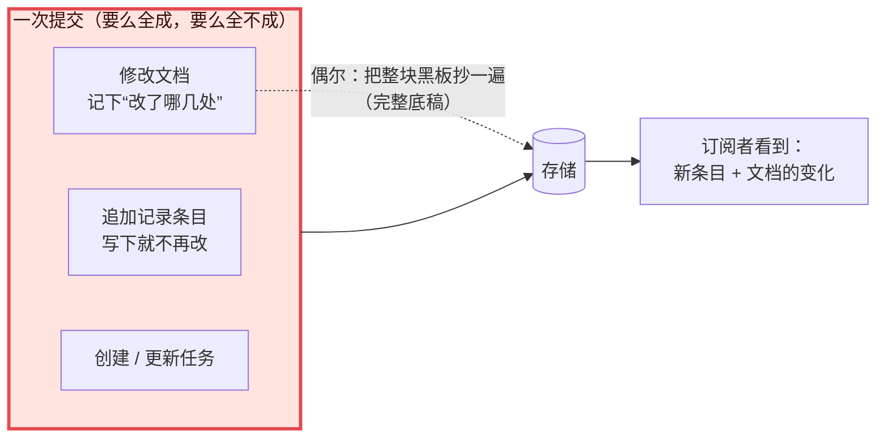

# 07 · 文档：和记录一起提交的“小黑板”　🟠P1

> **本课目标**
> 1. 分清“记录条目”（写下就不改）和“文档”（随时在变的 JSON 状态）；
> 2. 会用 `defineDoc` 定义自己的状态，并在提交里修改它；
> 3. 认识内置的五块“黑板”：智能体配置、服务方会话标识、进行中状态、收件箱、用量。
>
> **预计时间**：20 分钟

## 1. 先看图



## 2. 寓言：账本旁的小黑板

> 📜 **寓言 · 账本旁的小黑板**
>
> 还是那家米行。账本越记越厚，掌柜发现有些事不适合记进账本：比如“今天还要办的事”。早上写“买麻袋”，中午办完要划掉，下午又添一条“修秤”。要是每改一次就在账本上新写一页，账本会被这些琐事塞满，想知道“现在还剩哪些事”，得从头翻到尾。
>
> 于是掌柜在账本旁边挂了块小黑板，专写这种一直在变的东西。但他立了规矩：**改黑板也得用那支唯一的笔，而且要和那一页账一起写**——收了王家的米，就在同一笔里把黑板上的“收王家米”划掉。账写了一半作废，黑板上那一划也作废。
>
> 每次改黑板，掌柜还会在账本页脚记一小行：“黑板：划掉第 2 条，添一条修秤。”每隔一阵子，他干脆把黑板上的全部内容**整整齐齐抄一遍**进账本。
>
> 又一次发大水，这回黑板被冲走了。
>
> 掌柜不慌。他翻到账本里最后一次“整块抄下来”的那一页，照着重新写了一块黑板，再把那一页之后页脚上的小字一条一条照着改上去：划掉第 2 条，添一条修秤……改到最后一页盖了章的地方，停下。
>
> 新黑板和冲走的那块，一个字都不差。伙计们这才明白，为什么掌柜要在页脚记那些小字，又为什么时不时要整块抄一遍：**黑板可以丢，只要账本在，它就能一模一样地长回来；整块抄过的那页，让他不必从第一页开始改。**

<details>
<summary>🔍 揭晓：故事里的东西分别是什么？</summary>

| 故事里 | pi-durable 里 |
|---|---|
| 账本里的每一页记录 | 记录条目（Entry）：写下就不再改 |
| 小黑板 | **文档**（Document）：随时在变的 JSON 状态 |
| 改黑板要用同一支笔、和账一起写 | 文档只能在提交里改，和条目、任务**原子地**一起落盘 |
| 页脚的小字“划掉第 2 条……” | 每次提交记下的**变更操作**（Chord 库的 ops） |
| 整块抄一遍 | 完整**底稿**（base）：`checkpointWhen` 返回 `true` 时存一份完整值 |
| 照着最后一份底稿 + 之后的小字重建黑板 | 打开存储时：底稿 + 回放之后的变更 = 当前值 |
| 不必从第一页开始改 | 底稿限制了回放的长度 |

</details>

## 3. 概念拆解

### 3.1 定义一块黑板

```ts
import { defineDoc } from "@earendil-works/pi-durable";

const Todos = defineDoc<{ items: string[] }>({
  kind: "app.todos",          // 种类名
  version: 1,
  scope: "conversation",      // 归谁：整个会话 session / 某个对话 conversation / 某个任务 task
  history: "latest",          // 只保留最新值；"rewindable" 可以用 snapshotAsOf() 读旧值
  fork: "initial",            // 分叉出的新对话从什么开始："initial" 初始值 / "current" 当前值 / "asOf" 分叉点那时的值
  initial: () => ({ items: [] }),
  checkpointWhen: () => false, // 必填：返回 true 时，这次变化存成完整底稿，限制回放长度
});
```

### 3.2 在提交里改，像改普通对象一样

```ts
await root.commit(async (tx) => {
  (await tx.doc(Todos, root.id)).items.push("写文档");   // 拿到的是“草稿”，直接改
}, context);
console.log(await harness.snapshot(Todos, root.id, context)); // 读已提交的值
```

`tx.doc()` 返回的是一份**草稿**：你像改普通 JS 对象一样改它，Chord 库在背后记下每一处改动。回调结束时草稿立即作废（第 1 课的不变式 6），写进去的值必须是严格的 JSON。

### 3.3 归属决定寿命

- `scope: "task"` 的文档跟着任务走：**任务结束的那次提交里，它名下的文档一起退役**（规范 §5.3）。适合放“这个任务的大量中间进度”。
- 规范还建议：任务的检查点和小备忘要小，**大块的进度放进文档**。

### 3.4 内置的五块黑板

| 文档 | 放什么 |
|---|---|
| `pi.agent` | 这个对话用什么跑：模型、思考强度、选了哪些扩展和工具、额外指令、工作目录 |
| `pi.provider` | 发给模型服务方的会话标识（让服务方的提示词缓存命中） |
| `pi.live` | 正在进行的事：流式输出中的回答、重试、正在跑的工具及其输出、压缩 |
| `pi.inbox` | 对话忙时排队的提交单（第 8 课） |
| `pi.usage` | 用量与花费，按“服务方/模型”和工具名统计 |

界面要显示的一切，都在“条目 + 这几块黑板”里——这就是第 17 课“订阅变化”的基础。

## 4. 动手

[`labs/07-doc.ts`](../labs/07-doc.ts)：先提交“买菜”，再在一次会抛错的提交里加“洗碗”。

```text
  回滚： 提交回调里抛错
  黑板上： {"items":["买菜"]}        ← “洗碗”跟着那次提交一起作废了
```

## 5. 思考题

1. “用户当前打开的文件列表”应该放在条目里，还是文档里？
<details><summary>参考答案</summary>

文档。它一直在变，大家关心的是“现在是什么”，而不是每一次变化的历史。如果某次变化需要让模型看到，再追加一条条目（比如第 8 课的“直接记一笔”）。

</details>

2. 为什么 `checkpointWhen` 被设计成必填，而不是给个默认值？
<details><summary>参考答案</summary>

因为只有你知道这块黑板的变化模式：是偶尔整块替换，还是频繁小改？什么时候存完整底稿，是“写入大小”和“打开时回放长度”之间的取舍。必填就是逼你想一想。

</details>

## 小结

**黑板可以丢，只要账本在，它就能一模一样地长回来。**

👉 源码：[`src/documents.ts`](https://github.com/earendil-works/pi/blob/136b87e8a7f5a3e5186de0289523ba327dc592fc/packages/durable/src/documents.ts#L39)　·　规范 §3 文档：<https://github.com/earendil-works/pi/blob/136b87e8a7f5a3e5186de0289523ba327dc592fc/packages/durable/docs/spec.md#3-documents>
