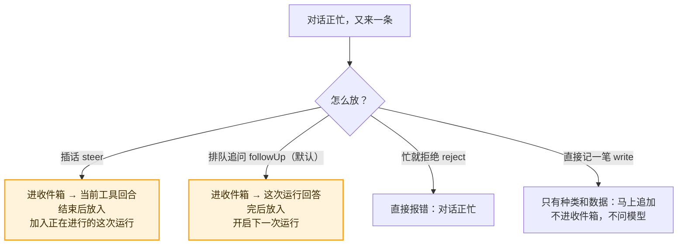

# 08 · 收件箱：对话正忙时，新消息怎么放　🟠P1

> **本课目标**
> 1. 掌握对话忙时提交的四种放法：插话、排队追问、拒绝、直接记一笔；
> 2. 知道它们分别在哪个“边界”被放进记录；
> 3. 会撤回一张排队中的提交单。
>
> **预计时间**：20 分钟

## 1. 先看图



## 2. 寓言：饭馆跑堂

> 📜 **寓言 · 饭馆跑堂**
>
> 饭馆里，三号桌点了一份宫保鸡丁，厨房正在炒。这时三号桌的客人先后跟跑堂说了四句话。
>
> 第一句：“少放辣！”跑堂没有冲进厨房去抢锅铲。他等大厨颠完这一锅、把菜倒进盘子之前的那个空当，把话递了进去。大厨在出锅前调了味。
>
> 第二句：“再来碗米饭。”跑堂把它记在单子的下一行。等宫保鸡丁端上桌，厨房才开始盛米饭。
>
> 第三句是旁边一位过路的客人问的：“要是厨房忙，我就不点了。”跑堂实话实说：“正忙着呢。”那人点点头走了，厨房那边什么也没多出来。
>
> 第四句：“我们挪到靠窗那桌了啊。”这句话跟做菜无关，跑堂当场在桌位牌上改了一笔，转身就走，连厨房都没进。
>
> 过了一会儿，客人又喊：“米饭不要了。”跑堂把单子下一行那碗米饭划掉——反正还没开始盛。
>
> 新来的跑堂看得眼花，老跑堂教他：“客人的话就三种：要**掺进正在做的这道菜**里的，等颠完这一锅递进去；要**等这道菜上完再做**的，记在下一行；**只需要记下来**的，当场记，别去烦厨房。还有一种客人说‘忙就算了’，那就告诉他忙。”

<details>
<summary>🔍 揭晓：故事里的东西分别是什么？</summary>

| 故事里 | pi-durable 里 |
|---|---|
| 厨房正在炒 | 对话正忙：一次运行进行中 |
| 跑堂的单子 | 收件箱文档 `pi.inbox` |
| “少放辣”，颠完这一锅递进去 | **插话** `whenBusy: "steer"`：放在当前**工具回合之后**，加入正在进行的运行 |
| “再来碗米饭”，上完菜再做 | **排队追问**（默认 `followUp`）：这次运行**回答之后**放入，开启下一次运行 |
| “忙就不点了” | `whenBusy: "reject"`：抛出 `ConversationBusy`（对话正忙） |
| “挪到靠窗那桌”，当场记 | **直接记一笔** `type: "write"`：只有种类和数据时**立即追加**，不排队、不问模型 |
| “米饭不要了” | `await submission.abort(context)`：撤回排队中的提交单 |

</details>

## 3. 概念拆解

### 3.1 四种放法

```ts
await root.submit({ type: "input", content: "顺便跑一下测试" }, context);                      // 排队追问（默认）
await root.submit({ type: "input", content: "用 pnpm，别用 npm", whenBusy: "steer" }, context); // 插话
await root.submit({ type: "input", content: "空闲才做", whenBusy: "reject" }, context);         // 忙就抛 ConversationBusy
await root.submit({ type: "write", entry: { kind: "app.note", data: "用户打开了一个文件" } }, context); // 直接记一笔
```

### 3.2 “直接记一笔”的细节

- 只有 `kind` 和 `data` 的记录，**不改变模型能看到的任何东西**，所以马上追加、从不排队。聊天消息因此能在发送瞬间出现在记录里。
- 正因为如此，它可能出现在**更早提交但仍在排队**的消息前面。例外：排在一个“重置”后面时会等着，免得被重置藏起来。
- 如果这条记录带了 `model`（给模型看的内容）、`head` 或 `edits`，它就会像插话一样，等到下一个边界才放入。

### 3.3 边界：放入的时机

收件箱里的东西只在**回合边界**被放进记录，具体放法在第 5 课那次“交接棒”的提交里：

- **工具回合之后**（postTools）：放入插话；
- **运行结束时**（final）：放入排队追问，并开启下一次运行。

默认每个边界只放一条；设置 `steeringMode: "all"` / `followUpMode: "all"` 就一次全放。

### 3.4 用别的样子显示一条输入

想让一条输入在记录里显示成“某人@了智能体”，但模型仍然把它当用户消息：

```ts
await root.submit({
  type: "input",
  content: "ann：能看看构建吗？",                                           // 模型看到的
  entry: { kind: "chat.mention", data: { author: "ann", text: "能看看构建吗？" } }, // 记录里存成这个种类
}, context);
```

种类名不能以 `pi.` 开头。

### 3.5 运行失败之后

一次运行因模型出错而失败时，排在后面的输入默认**继续等着**，直到下一条输入到来。设置 `afterFailedRun: "continue"` 就像正常回答后那样接着跑；设为 `"withdraw"` 则把它们以“没被回答（`run_failed`）”结束。[^failures]

## 4. 动手

[`labs/05-inbox.ts`](../labs/05-inbox.ts)：工具 `cook` 正在跑时，先插话“少放辣！”，再排队“再来碗米饭”。

```text
收件箱里排着： steer, followUp
  pi.user         来一份宫保鸡丁
  pi.system
  pi.assistant    [call cook]
  pi.tool-result  宫保鸡丁 做好了
  pi.user         少放辣！                    ← 插话：工具回合之后放入
  pi.assistant    宫保鸡丁上桌，已按要求少放辣。
  pi.user         再来碗米饭                  ← 排队追问：回答之后放入，开启下一次运行
  pi.assistant    米饭马上来。
```

<div class="sim" data-sim="inbox">🕹️ 交互模拟器“饭馆跑堂”：请在网页版课程中打开。</div>

## 5. 思考题

1. 用户在模型长时间运行时说“停，方向错了”，应该用插话，还是先 `abort()` 再提交？
<details><summary>参考答案</summary>

取决于你想不想保留正在进行的工作。插话会在当前工具回合结束后让模型看到这句话，已经启动的工具会跑完；如果那些工具本身就是错的（比如正在大规模改文件），应该先 `abort()` 停下，再提交新输入。

</details>

2. 为什么插话不立刻塞进正在进行的模型请求里？
<details><summary>参考答案</summary>

模型请求一旦发出，提示词就定了；工具调用也都已经提交成任务。只有在回合边界放入，记录的顺序才和模型实际看到的顺序一致——崩溃恢复和多人观看看到的才是同一个故事。

</details>

## 小结

**要掺进这道菜的、等这道菜上完再做的、只需记下来的——各有各的放法。**

👉 源码：[`src/harness/inbox.ts`](https://github.com/earendil-works/pi/blob/136b87e8a7f5a3e5186de0289523ba327dc592fc/packages/durable/src/harness/inbox.ts#L21)　·　规范 §6 提交单与收件箱：<https://github.com/earendil-works/pi/blob/136b87e8a7f5a3e5186de0289523ba327dc592fc/packages/durable/docs/spec.md#6-submissions-and-inbox>

[^failures]: 官方说明“失败与恢复”一节：<https://github.com/earendil-works/pi/blob/136b87e8a7f5a3e5186de0289523ba327dc592fc/packages/durable/README.md#failures-and-recovery>
