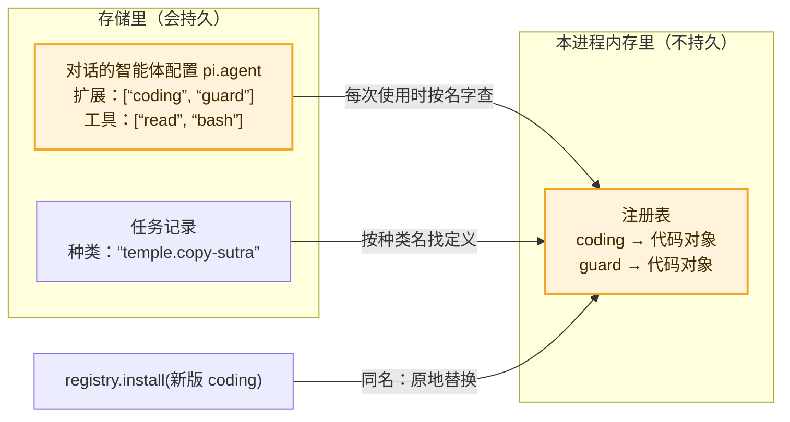

# 09 · 扩展、注册表与热重载：只存名字，不存代码　🟠P1

> **本课目标**
> 1. 会用 `defineExtension` 打包工具、提示词段落、钩子、任务；
> 2. 理解为什么对话里**只存扩展的名字**；
> 3. 知道热重载时，正在跑的工作用旧代码、下一步用新代码。
>
> **预计时间**：25 分钟

## 1. 先看图



## 2. 寓言：戏单上的角色名

> 📜 **寓言 · 戏单上的角色名**
>
> 有个戏班常年走南闯北。班主写戏单有个怪习惯：**只写角色，不写演员**。“《单刀会》：关公、鲁肃、周仓。”谁来演，一个字没有。
>
> 年轻人笑他：别的戏班都把名角的名字印得老大，咱们这样谁买账？
>
> 那年冬天，唱关公的老张病倒了，老李连夜顶上。戏单一个字都不用改，照样贴出去，照样开锣。
>
> 开春，班里请来一位更好的关公。那天下午这场《单刀会》已经开锣，老张正在台上。班主说：“这场让老张唱完。下一场，换新人。”台下的戏一句没断。
>
> 到了夏天，演曹操的那拨人整个去了别的班子。戏单上还写着“曹操”，班主也没划掉——有曹操的那几折先不唱，其余照演。秋天来了个新的曹操，戏单还是那张戏单，那几折又唱起来了。
>
> 最后年轻人服了。班主说：“人会病、会走、会换，戏不能跟着人走。**戏单上只写角色；每一场开锣前，我才去后台看看今天是谁来演。**”

<details>
<summary>🔍 揭晓：故事里的东西分别是什么？</summary>

| 故事里 | pi-durable 里 |
|---|---|
| 戏单 | 对话的智能体配置文档 `pi.agent`，以及任务记录里的种类名 |
| 只写角色名 | **只存名字**：扩展名、工具名、任务种类名；代码不进存储 |
| 后台今天有谁 | 本进程的**注册表**（Registry） |
| 开锣前去后台看 | **每次使用时**按名字到注册表里解析 |
| 老李顶替老张 | 重启后重新 `install` 同名扩展 |
| 新关公：这场让老张唱完，下一场换 | **热重载**：正在跑的工具调用用旧实现跑完；下一个阶段、下一次请求、下一次调用用新代码 |
| 曹操那拨人走了，那几折先不唱 | 扩展被卸载：选了它的对话暂时得不到它，直到再次安装 |
| 戏单不用改 | 存储里的名字一直有效 |

</details>

## 3. 概念拆解

### 3.1 一个扩展能带什么

```ts
import { createRegistry, defineExtension, hook, section, ToolTask } from "@earendil-works/pi-durable";
import { CodingTools } from "@earendil-works/pi-durable/tools";   // 内置的 read / write / edit / bash

const Coding = defineExtension({
  name: "coding",                                                         // 名字：唯一会被存下来的东西
  sections: [section("preamble", () => "你是一个简洁的编程助手。", { tag: false })], // 系统提示词段落
  hooks: [hook(ToolTask, { beforeTool: (call) => (危险吗(call) ? { block: "需要批准" } : undefined) })], // 钩子
  // tools: [...]  工具      wraps: [...]  按名字装饰别的工具或段落      tasks: [...]  自定义任务
});

const registry = createRegistry();
registry.install(CodingTools);
registry.install(Coding);
```

默认情况下，每个对话都选中所有已安装的扩展，按安装顺序。[^ext]

### 3.2 只存名字

```ts
await root.configure({
  model: { provider: "openai", modelId: "某个模型" },
  extensions: { remove: [Coding] },   // 在宿主默认选择上去掉一个；传数组则精确指定
  tools: [readTool, bashTool],        // 传数组：只启用这些
  modelTools: [readTool],             // 其中只把 read 提供给模型；工具之间仍可以调 bash
  instructions: "只读，不要改文件。",
  cwd: "/work/repo",
}, context);
```

扩展和工具是**以对象传入、以名字存下**的。所以存下的名字比代码活得久：扩展被卸载后，选了它的对话只是暂时得不到它，再装回来就恢复。[^agent]

### 3.3 热重载：同名即替换

```ts
registry.install(await loadCodingExtension());   // 同名 "coding"：原地替换已安装的那个
registry.uninstall(Coding);                      // 按名字卸载，不管是不是同一个对象
```

规则只有一条：**已经开始的工作，用它开始时拿到的代码。**

- 正在运行的工具调用，用旧实现跑完；
- 任务的每个阶段在**阶段开始时**从注册表解析一次钩子和智能体配置；
- 下一个阶段、下一次请求、下一次调用，用新代码。[^reload]

### 3.4 重启后：先装扩展，任务才能继续

进程重启后要**重新安装同样的扩展**。某个扩展里定义的任务，在它被装上之前一直等着（任务图里能看到“被阻塞”的原因）。装上之后，注册表的变化会让调度器把它们重新跑起来。

### 3.5 同名工具：后来者赢

两个都被选中的扩展里有同名工具时，**后安装的替换先安装的**；`wrapTool()` 则装饰“赢了的那个”：

```ts
const Timing = defineExtension({
  name: "timing",
  wraps: [wrapTool(createBashTool(), (bash) => ({ ...bash, execute: (args, api, ctx) => 计时(() => bash.execute(args, api, ctx)) }))],
});
```

### 3.6 提示词段落与缓存

系统提示由被选中扩展的段落按顺序拼成，每次请求前渲染。段落和工具的变化以“系统提示条目”的形式存进记录，**只有变化的部分才会再发一次**，这样服务方的提示词缓存能一直命中。一个每次都返回不同内容的段落（比如“当前时间”）会破坏这一点。[^prompt]

### 3.7 设置：每次使用时读，从不存储

`Harness.open(storage, { settings })` 里的设置每次用到时才读，永远不存进库里，所以可以写成 getter，接到配置文件上，改了立即生效。

## 4. 思考题

1. 为什么不把工具的代码（或者至少是描述）存进库里，这样换了机器也能跑？
<details><summary>参考答案</summary>

代码属于部署，不属于数据。存代码就要处理“库里的旧代码和磁盘上的新代码哪个算数”、安全审查、依赖版本等一堆问题。只存名字，库永远只说“要什么”，进程负责“由谁来做”。

</details>

2. 你给 `deploy` 工具发布了一个 bug 修复版，正在跑的那次部署会用新代码吗？
<details><summary>参考答案</summary>

不会，它用旧实现跑完。下一次 `deploy` 调用才用新代码。如果在跑的过程中崩溃了，恢复阶段会用**当前**的定义去判断能否重做（第 3 课：存下的策略和现在的定义都得是 safe）。

</details>

## 小结

**戏单上只写角色，每场开锣前才看谁来演。**

👉 源码：[`src/harness/registry.ts` 第 73 行 `install`](https://github.com/earendil-works/pi/blob/136b87e8a7f5a3e5186de0289523ba327dc592fc/packages/durable/src/harness/registry.ts#L73)　·　规范 §7.1、§7.5：<https://github.com/earendil-works/pi/blob/136b87e8a7f5a3e5186de0289523ba327dc592fc/packages/durable/docs/spec.md#71-extensions-registry-and-agent-resolution>

[^ext]: 官方说明“扩展”一节：<https://github.com/earendil-works/pi/blob/136b87e8a7f5a3e5186de0289523ba327dc592fc/packages/durable/README.md#extensions>
[^agent]: 官方说明“每个对话的智能体”一节：<https://github.com/earendil-works/pi/blob/136b87e8a7f5a3e5186de0289523ba327dc592fc/packages/durable/README.md#per-conversation-agent>
[^reload]: 官方说明“热重载”一节：<https://github.com/earendil-works/pi/blob/136b87e8a7f5a3e5186de0289523ba327dc592fc/packages/durable/README.md#reload>
[^prompt]: 官方说明“系统提示”一节：<https://github.com/earendil-works/pi/blob/136b87e8a7f5a3e5186de0289523ba327dc592fc/packages/durable/README.md#system-prompt>
