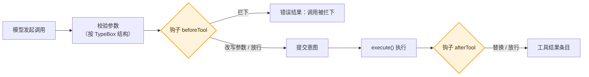

# 10 · 工具与钩子：衙门口的门房　🟠P1

> **本课目标**
> 1. 会用 `defineTool` 写工具，知道结果的三个“通道”；
> 2. 会用钩子拦下、改写、替换工具调用；
> 3. 了解“工具调工具”和“谁可以调这个工具”。
>
> **预计时间**：30 分钟

## 1. 先看图



## 2. 寓言：衙门口的门房

> 📜 **寓言 · 衙门口的门房**
>
> 县衙大门口有个门房，老秦。百姓递进去的状纸、送出来的批文，都要从他手里过一遍。
>
> 有人递来一张状纸，要“把城东的河堤扒了”。老秦看了一眼，退了回去，在背面写：“此事须县太爷亲批。”状纸没进门，可那人手里多了一张写着“为何不收”的纸。
>
> 又有人的状纸上把“城西”写成了“城晒”。老秦提笔改成“城西”，盖了个小章，放了进去。里头办事的人只看到改好的那张。
>
> 批文出来时，老秦也要看一眼。有一份批文里抄了原告的家宅住址，他用墨涂掉，再递出去。
>
> 衙门里还有些文书，只许师爷递，不许百姓直接递；有些只许百姓递，师爷不能替人递。老秦都记着。师爷替一桩案子去调卷宗，老秦也会问一句：“这是替哪张状纸调的？”
>
> 有一回老秦闹肚子，换了个毛手毛脚的小厮看门。小厮收状纸时自己先出了岔子，慌了神——按衙门的规矩，**看门的出了错，那张状纸就当是被拦下了**，宁可让百姓再来一趟，也不能让一张没人看过的状纸混进去。
>
> 县太爷后来说：“门房不办案，可衙门的规矩，都在他那一进一出之间。”

<details>
<summary>🔍 揭晓：故事里的东西分别是什么？</summary>

| 故事里 | pi-durable 里 |
|---|---|
| 递进去的状纸 | 一次工具调用 |
| 门房老秦 | **钩子**（hook），挂在工具任务上 |
| 退回并写“须亲批” | `beforeTool` 返回 `{ block: "原因" }`：模型得到一条“调用被拦下”的错误结果 |
| 改错字再放进去 | `beforeTool` 返回 `{ arguments: 新参数 }`：工具用改写后的参数执行 |
| 涂掉住址再递出去 | `afterTool` 替换结果（比如脱敏） |
| 只许师爷递 / 只许百姓递 | 工具的 `callers`：`["tools"]` 只许别的工具调用，`["model"]` 只许模型调用 |
| 师爷替案子调卷宗 | 工具调工具：`api.executeTool()`；钩子能看到 `call.parent` |
| 看门的出错 → 当作拦下 | `beforeTool` 钩子抛错 → 这次调用被拦下 |

</details>

## 3. 概念拆解

### 3.1 定义一个工具

```ts
import { Type } from "@earendil-works/pi-ai";

const count = defineTool({
  name: "count",
  description: "从 1 数到 n",
  parameters: Type.Object({ n: Type.Number() }),   // TypeBox 结构：既是类型，也用于运行时校验（第 22 课）
  // replay: "safe",            崩溃后可安全重做（第 3 课），默认不可
  // callers: ["model"],        谁可以调用：模型、其他工具，或两者（默认）
  // executionMode: "sequential", 被调用时整轮工具改为依次执行
  execute: async (args, api) => {                  // args 的类型从 parameters 自动推出
    for (let i = 1; i <= args.n; i++) api.output(`${i}\n`);   // 流式输出；不返回 output 时它就是结果
    return {};
  },
});
```

`execute()` 抛错 → 模型得到一条错误结果。

### 3.2 结果的三个通道

| 通道 | 给谁 | 存进记录吗 |
|---|---|---|
| `output` | 模型 | ✅ |
| `structuredOutput` | 调用这个工具的程序（工具调工具、代码模式） | ❌ |
| `details` | 界面 | ✅ |

结果还可以带 `usage`（计入用量）和 `control`：`{ terminate: true }`（这一轮所有工具都这么说时，运行结束、不再请求模型）、`{ handoff: "交接说明" }`（开始新的上下文）。

### 3.3 钩子

```ts
const Guard = defineExtension({
  name: "guard",
  hooks: [
    hook(ToolTask, { beforeTool: (call) => (call.name === "bash" ? { block: "这里禁用 bash" } : undefined) }),
    hook(GenerationTask, { onYield: (answer) => (还没做完(answer) ? { continue: "继续。" } : undefined) }),
  ],
});
```

| 挂在哪 | 钩子 | 能做什么 |
|---|---|---|
| 生成任务 | `beforeRequest` | 替换某一次请求的消息 |
| 生成任务 | `afterResponse` | 看到模型的回复 |
| 生成任务 | `onYield` | 模型要收工时，用一条新的用户消息让它继续 |
| 生成任务 | `afterTools` | 一轮工具都结束后运行 |
| 工具任务 | `beforeTool` | 拦下，或改写参数 |
| 工具任务 | `afterTool` | 替换结果 |

钩子只在**选中了它所在扩展**的对话里生效。想只对部分对话生效，就只在那些对话里选中它：`configure({ extensions: { add: [Guard] } })`。

**钩子抛错**：会被报告并跳过；但 `beforeTool` 抛错等于拦下这次调用（宁严勿松）。这一点在第 3 课的 `call` 阶段源码里能看到：`catch (error) { block = errorMessage(error); }`。

### 3.4 工具调工具

```ts
const testsPass = defineTool({
  name: "tests_pass", description: "跑测试，告诉我过没过", parameters: Type.Object({}),
  execute: async (_args, api, context) => {
    const run = await api.executeTool("bash", { command: "npm test" }, context, { progress: false });
    const exitCode = (run.structuredOutput as { exitCode: number } | undefined)?.exitCode;
    return { output: [{ type: "text", text: exitCode === 0 ? "通过" : "失败" }] };
  },
});
```

- 嵌套调用是**它自己的工具任务**，归调用它的那个工具所有：同样校验参数、同样过钩子、有自己的重做策略。
- 每个嵌套调用有一个**键**（默认是它在调用方里的序号）。可安全重做的调用方崩溃后重跑、按同样顺序调用时，会**拿回已经发起过的嵌套调用**，而不是再起一个。
- 调用方结束前，它留下还在跑的嵌套调用会被中止。[^nested]

### 3.5 谁可以调

```ts
const codemode = defineTool({ name: "codemode", callers: ["model"], /* … */ });          // 脚本不能再启动脚本
const search   = defineTool({ name: "mcp__github__search", callers: ["tools"], /* … */ }); // 从不提供给模型
await root.configure({ modelTools: [codemode] }, context);  // 只把 codemode 给模型，它的脚本再去调别的工具
```

`deferred: true` 的工具在被“加载”之前不提供给模型，适合工具特别多的场景（配合 `tool_search` 工具按需加载）。

## 4. 动手

[`labs/09-hook.ts`](../labs/09-hook.ts)：模型同时调用 `shell("ls")` 和 `shell("rm -rf /")`，`beforeTool` 钩子拦下后者。

```text
  ❌ [error] Tool call blocked: 门房：这条命令需要人工批准     ← 被拦下（Tool call blocked = 调用被拦下）
  ✅ ran: ls
```

## 5. 思考题

1. 用 `afterTool` 给 `output` 脱敏时，要注意什么？
<details><summary>参考答案</summary>

如果这个工具声明了 `structuredOutputSchema`，`structuredOutput` 里很可能有同样的敏感信息，官方说明特别提醒要**一起脱敏**。[^tools]

</details>

2. 为什么 `beforeTool` 在“提交意图”之前，而不是之后？
<details><summary>参考答案</summary>

意图里存的是**最终要执行的参数**和重做策略。钩子可能改参数、可能拦下；只有它们都定了，才知道要记下的“意图”是什么。被拦下的调用直接写一条结果结束，根本没有意图要记。

</details>

## 小结

**门房不办案，可规矩都在他那一进一出之间。**

👉 源码：[`src/harness/define.ts`](https://github.com/earendil-works/pi/blob/136b87e8a7f5a3e5186de0289523ba327dc592fc/packages/durable/src/harness/define.ts#L13)　·　规范 §7.2 钩子、§7.3 工具：<https://github.com/earendil-works/pi/blob/136b87e8a7f5a3e5186de0289523ba327dc592fc/packages/durable/docs/spec.md#72-hooks>

[^nested]: 官方说明“工具调工具”一节：<https://github.com/earendil-works/pi/blob/136b87e8a7f5a3e5186de0289523ba327dc592fc/packages/durable/README.md#calling-tools-from-tools>
[^tools]: 官方说明“工具”一节：<https://github.com/earendil-works/pi/blob/136b87e8a7f5a3e5186de0289523ba327dc592fc/packages/durable/README.md#tools>
