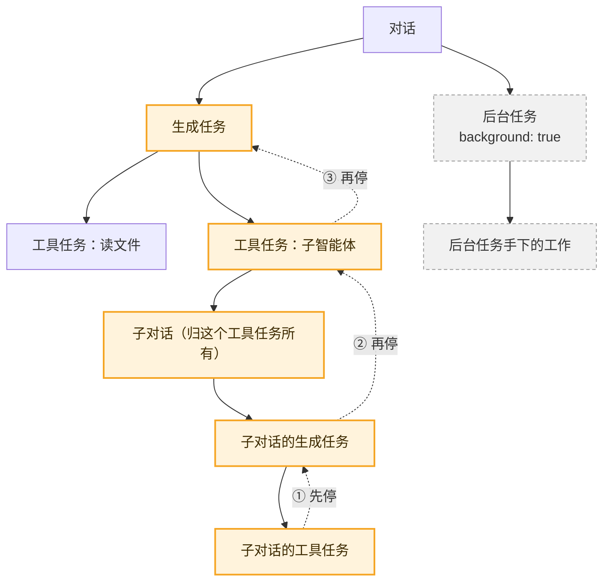

# 11 · 归属树与中止：自下而上地收场　🟠P1

> **本课目标**
> 1. 知道每个任务都有“主人”：它的对话，或者另一个任务；
> 2. 理解中止为什么**自下而上**：先停手下的，再停自己；
> 3. 会用 `background: true` 划出一块“不跟着父亲一起停”的工作。
>
> **预计时间**：25 分钟

## 1. 先看图



中止对话时：虚线箭头的顺序就是收场顺序，**最底下的先停**；灰色的后台任务不受影响。

## 2. 寓言：马戏团拆帐篷

> 📜 **寓言 · 马戏团拆帐篷**
>
> 马戏团在小镇演完最后一场，团长吹哨：“收摊！”
>
> 马戏团收摊有讲究：<strong>谁搭的谁拆，从最上面、最里面的东西开始拆。</strong>空中飞人先把秋千上的绳索解下来，秋千架才能拆；秋千架拆完，大帐篷的顶才能落；顶落了，才拔地上的桩子。驯兽师的小棚子是他自己搭的，归他自己收；棚子里的笼子，又是他手下的小徒弟搭的，得等小徒弟先收好笼子，他才动手拆棚子。
>
> 有一年来了个急性子的新管事，一吹哨就去拔大帐篷的主桩。帐篷轰的一声塌下来，把还挂在半空的秋千和绳索全压在了底下，演员们在布底下爬了半天才钻出来。从此再没人敢这么干。
>
> 团长也不能先走。哪怕大帐篷已经拆完，只要驯兽师的笼子还没装上车，他就得在空地上等着——**手下还有人在忙，他就不算收完。**
>
> 场边还有一辆卖糖葫芦的小推车，是老王自己的买卖，一路跟着马戏团走，但不归团长管。团长吹“收摊”，老王照卖不误；马戏团在不在演出，也不影响他什么时候收工。只有团长特意喊一声“**连老王的车也一起收**”，老王才推车走人。
>
> 每次看完收摊，镇上的孩子都会发现：拆的顺序，和搭的时候**正好反过来**；而每样东西，**都是当初搭它的那个人自己拆的。**

<details>
<summary>🔍 揭晓：故事里的东西分别是什么？</summary>

| 故事里 | pi-durable 里 |
|---|---|
| 谁搭的谁拆 | 每个任务都有**主人**（它的对话，或另一个任务）；每个任务的 `abort` 处理函数**撤销自己造成的效果** |
| 从最上面、最里面开始拆 | **自下而上中止**：先中止它拥有的工作，等那些都结束了，才运行它自己的 `abort` |
| 先拔主桩，帐篷压住秋千 | 先停父任务、不管子任务 → 子任务的效果没人收拾 |
| 团长得等笼子装车 | 父任务要等它拥有的工作全部空闲，自己才算空闲 |
| 老王的糖葫芦车 | `background: true` 的任务：一道**边界**，它拥有的工作不随父亲中止，也不让父亲一直“忙” |
| “连老王的车也一起收” | `root.abort(context, { background: true })` |

</details>

## 3. 概念拆解

### 3.1 每个任务都有主人

创建任务时必须说明归属：

```ts
await tx.createTask(Deliver, input, { ownership: { kind: "conversation" } });           // 归它的对话
await tx.createTask(Payment, input, { ownership: { kind: "task", taskId: task.id } });  // 归另一个任务
await harness.createConversation({ ownership: { kind: "ownerless" } }, context);        // 对话可以没有主人
```

对话也可以**归一个任务所有**，这就是子智能体：工具在 `api.commit()` 里创建子对话，`ownership: { kind: "task", taskId: api.taskId }`，然后通过 `api.conversation(id)` 驱动它。[^sub]

### 3.2 中止是自下而上的

规范 §5.5 的规则：中止一个任务，**先中止它拥有的工作**；它自己的中止处理函数只在那些工作都结束后才开始。这样每个任务都只撤销自己的效果。[^child]

```text
提交中止标记（持久的）
→ 子孙任务先各自运行 abort、提交最终结局
→ 自己运行 abort、提交最终结局
```

中止标记是**持久的**：中止进行到一半崩溃了，重启后接着收场，不会半途而废。

### 3.3 归属带来的三条规则

- 中止一个工具调用，会中止它的子对话；工具调用**失败**也一样：`execute()` 抛错，或者一个不可重做的调用被崩溃打断。
- 父亲要等孩子空闲，自己才空闲。
- `background: true` 是一道边界：它拥有的工作**不随父亲中止**，也**不让父亲忙着**。

### 3.4 重启时“抛弃”的任务

有些任务只被创建者“在内存里”等待，重启后创建者不会再管它。这种任务可以用 `abandonOnRestart: true` 创建：下一个进程开始调度时发现它还活着，就以 `abortReason: "restart"` 中止它（连同它拥有的一切），然后才运行别的。**不可重做的工具发起的嵌套调用，会自动得到这个标记。**[^abandon]

### 3.5 看整棵树

```ts
const graph = await harness.watchTaskGraph(context);
graph.start(async (value) => {
  for (const node of Object.values(value.tasks)) console.log(node.id, node.kind, node.state.status, node.owner ?? "（归对话）");
});
```

任务在创建它的那次提交里出现，在让它结束的那次提交里消失。

<div class="sim" data-sim="abort">🕹️ 交互模拟器“拆帐篷”：请在网页版课程中打开。</div>

## 4. 思考题

1. 子智能体工具为什么要声明 `replay: "safe"`？官方示例里它在重跑时做了什么？
<details><summary>参考答案</summary>

如果不可重做，崩溃会让这次调用“被打断”而失败，失败又会中止它拥有的子对话——子智能体干了一半的活全丢了。声明可重做后，重跑时先用 `tx.scanConversations({ ownerTaskId: api.taskId })` 找到**已经创建过的子对话**，再用请求号 `subagent:${api.taskId}` 提交，同一个提交单不会交两次（第 4 课）。

</details>

2. 为什么不让父任务的 `abort` 自己去把孩子们一个个收拾掉？
<details><summary>参考答案</summary>

父任务不知道孩子做过哪些外部动作，孩子自己最清楚；而且孩子可能还有孙子。统一自下而上，每一层只管自己，就不会漏，也不会两个人抢着拆同一样东西。

</details>

## 小结

**拆的顺序和搭的顺序正好相反，每样东西都由搭它的人自己拆。**

👉 源码：[`src/harness/scheduler.ts` 第 1592 行（中止自下而上的说明）](https://github.com/earendil-works/pi/blob/136b87e8a7f5a3e5186de0289523ba327dc592fc/packages/durable/src/harness/scheduler.ts#L1592)、[第 1872 行 `#runAbort`](https://github.com/earendil-works/pi/blob/136b87e8a7f5a3e5186de0289523ba327dc592fc/packages/durable/src/harness/scheduler.ts#L1872)

[^sub]: 官方说明“中止与子智能体”一节：<https://github.com/earendil-works/pi/blob/136b87e8a7f5a3e5186de0289523ba327dc592fc/packages/durable/README.md#abort-and-subagents>
[^child]: 官方说明“子任务”一节：<https://github.com/earendil-works/pi/blob/136b87e8a7f5a3e5186de0289523ba327dc592fc/packages/durable/README.md#child-tasks>
[^abandon]: 官方说明“重启时被抛弃的任务”一节：<https://github.com/earendil-works/pi/blob/136b87e8a7f5a3e5186de0289523ba327dc592fc/packages/durable/README.md#tasks-a-restart-abandons>
