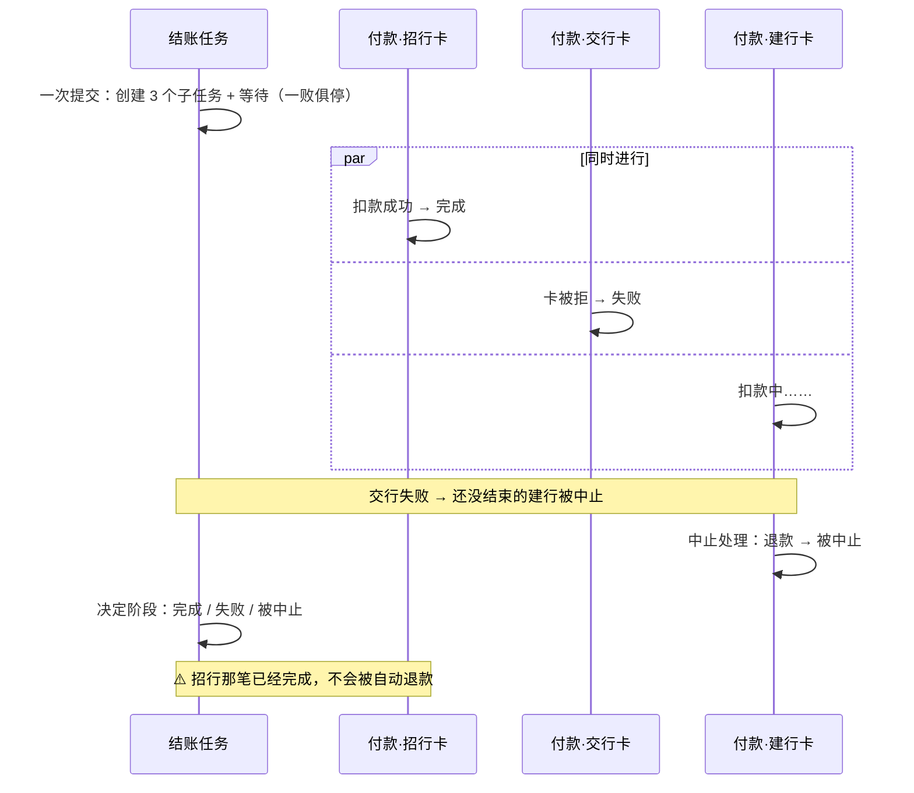

# 12 · 子任务：一败俱停，还是全部等完　🟠P1

> **本课目标**
> 1. 会让一个任务创建子任务，并以“等待”状态等它们；
> 2. 分清两种等法：`failFast`（一个失败就停掉其余的）和 `allSettled`（全部等完）；
> 3. 认清一个常见的坑：**已经成功的那一个，不会被自动撤销**。
>
> **预计时间**：25 分钟

## 1. 先看图



> 图中的招行卡、交行卡、建行卡，分别对应实验代码里的 `visa`、`amex`、`master`。

## 2. 寓言：分头买票

> 📜 **寓言 · 分头买票**
>
> 老陈带着三个孩子去旅游，要赶下午的船。到了码头，他把三个孩子派出去：老大去买船票，老二去买岛上的门票，老三去买回城的车票。他自己站在原地等，一步不挪。
>
> 他交代了一句：“**谁那边买不成，就喊一声，另外两个别买了，把钱退回来。**”
>
> 老大最先跑回来，船票到手。老二那边，窗口挂出“门票售罄”，他扯着嗓子喊了一声。老三正排到窗口，听到喊声，转身退出了队伍，把预付的定金要了回来。
>
> 人都回齐了，老陈一合计：门票没买到，这趟去不成了。一家人往回走。
>
> 走到半路，老大从兜里掏出一张纸：“爸，这张船票怎么办？”
>
> 老陈愣住了。他刚才那句话说的是“**另外两个别买了**”——可老大的票，在老二喊之前就已经买好了。“别买了”管不到已经买完的东西。这张船票，得他自己拿去码头退。
>
> 第二年再出门，老陈的交代变成了两句：“谁买不成就喊，其余的别买了。**都回来以后，我会把已经买到的票，一张一张拿去退掉。**”

<details>
<summary>🔍 揭晓：故事里的东西分别是什么？</summary>

| 故事里 | pi-durable 里 |
|---|---|
| 老陈 | 父任务（结账任务） |
| 三个孩子 | 三个子任务（付款任务），归父任务所有 |
| 站在原地等 | 父任务提交 `{ status: "waiting", on: [三个子任务], policy: "failFast" }`，等待期间不运行代码 |
| “谁买不成就喊，其余别买了” | `failFast`：第一个失败的子任务会让其余**还没结束的**子任务被中止 |
| 老三退出队伍、退定金 | 被中止的子任务运行自己的 `abort`：退款 |
| 人回齐后合计 | 父任务进入下一阶段 `decide`，用 `runtime.outcomes()` 读各子任务结局 |
| 老大手里已买好的船票 | 已经 `completed` 的子任务：**failFast 不会撤销它** |
| 第二年的第二句交代 | **补偿**（saga 模式）：父任务在 `decide` 里自己撤销已完成的那些 |

</details>

## 3. 概念拆解

### 3.1 创建并等待

```ts
pay: async (task, runtime, ctx) => {
  await runtime.commit(async (tx) => {
    const payments = [];
    for (const card of task.input.cards)
      payments.push(await tx.createTask(Payment, { card }, { ownership: { kind: "task", taskId: task.id } }));
    // 全部结束后在 decide 阶段继续；第一个失败会中止其余的
    return { status: "waiting", checkpoint: { phase: "decide", payments }, on: payments, policy: "failFast" };
  }, ctx);
},
decide: async (task, runtime, ctx) => {
  const outcomes = await runtime.outcomes(task.state.checkpoint.payments, ctx);
  // …提交结账自己的结局
},
```

注意“创建子任务”和“进入等待”在**同一次提交**里——又是第 5 课那个“不留缝”的套路。

### 3.2 两种等法

| 策略 | 什么时候醒来 | 失败时 |
|---|---|---|
| `allSettled` | `on` 里的任务**全部**结束 | 不干预，各跑各的 |
| `failFast` | 全部结束（包括被中止的） | 第一个失败的会让其余还没结束的被中止 |

`on` 也可以写别的任务（不是自己的孩子），但那时只能用 `allSettled`。

### 3.3 收尾中（completing）

父任务决定了结局，但它拥有的工作还在跑时，会进入 `completing`（收尾中）：结局已定，但要等那些工作结束才真正变成“已结束”，`waitForTask()` 也才返回。**结局是失败或被中止的，会先中止那些工作。**[^child]

### 3.4 坑：failFast 不是事务

failFast 只中止**还活着的**兄弟任务。已经完成的扣款不会被退回——要由父任务补偿：

```ts
decide: async (task, runtime, ctx) => {
  const outcomes = await runtime.outcomes(task.state.checkpoint.payments, ctx);
  const paid = outcomes.every((o) => o.status === "completed");
  if (!paid) {
    // 补偿：把已经成功扣款的退掉。decide 可能因崩溃重跑，所以退款也要用幂等键。
    for (const [i, o] of outcomes.entries())
      if (o.status === "completed") await bank.refund(`payment-${task.state.checkpoint.payments[i]}`);
  }
  await runtime.commit(() => ({ status: "terminal", outcome: paid ? … : … }), ctx);
},
```

想一想：这里的退款是一个外部动作，放在 `decide` 阶段里、最终提交之前——崩溃后 `decide` 会从头重跑，退款会再发一次。所以退款**必须**带幂等键（第 3 课的结论）。

## 4. 动手

```bash
node 04-checkout.ts   # 原版：只有 failFast
node 04b-saga.ts      # 改进版：decide 阶段补偿
```

原版真实输出：

```text
  💳 扣款 visa (payment-8)
  💳 扣款 amex (payment-9)
  💳 扣款 master (payment-10)
  ↩️  退款 payment-10                   ← 只有被中止的那笔退了款
  🧾 各笔付款： completed, failed, aborted
结账结果： {"status":"failed","error":{"message":"有一笔付款失败"}}
```

改进版多出一行：

```text
  ↩️  退款 payment-8                    ← 父任务补偿已完成的那笔
```

<div class="sim" data-sim="failfast">🕹️ 交互模拟器“分头买票”：请在网页版课程中打开。</div>

## 5. 思考题

1. 为什么付款任务的幂等键用 `payment-${task.id}`，而不是随机数？
<details><summary>参考答案</summary>

任务 id 在崩溃前后不变；付款阶段若在扣款后、提交前崩溃，重跑时用同一个键，银行就知道是同一笔，不会扣两次。随机数每次都不一样，等于没有键。

</details>

2. 如果要求“所有付款要么全成，要么全退”，能不能只靠 failFast 做到？
<details><summary>参考答案</summary>

不能。分布式的“全成或全退”只能靠补偿：失败后把已成功的逐一撤销。failFast 只是让你**早点**知道失败、少做一些无用功。

</details>

## 小结

**“别买了”管不到已经买完的票。** failFast 省事，补偿要自己写。

👉 官方完整示例：[`test/examples/23-child-tasks.ts`](https://github.com/earendil-works/pi/blob/136b87e8a7f5a3e5186de0289523ba327dc592fc/packages/durable/test/examples/23-child-tasks.ts)　·　规范 §5.5 结构化并发：<https://github.com/earendil-works/pi/blob/136b87e8a7f5a3e5186de0289523ba327dc592fc/packages/durable/docs/spec.md#55-structured-concurrency>

[^child]: 官方说明“子任务”一节：<https://github.com/earendil-works/pi/blob/136b87e8a7f5a3e5186de0289523ba327dc592fc/packages/durable/README.md#child-tasks>
