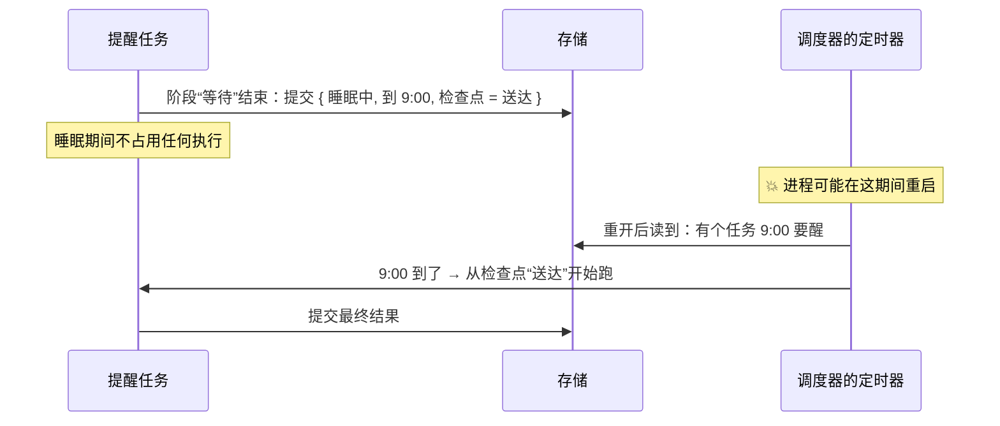

# 13 · 睡眠与唤醒：把“到点叫我”也存下来　🟠P1

> **本课目标**
> 1. 会用 `runtime.sleepUntil()` 让任务睡到某个时刻；
> 2. 记住：**阶段中间不能睡**，睡眠只能放在阶段末尾；
> 3. 了解会被平台“回收”的宿主（比如 Cloudflare Durable Object）怎么用 `onWake` 自己定闹钟。
>
> **预计时间**：20 分钟

## 1. 先看图



## 2. 寓言：客栈的叫早牌

> 📜 **寓言 · 客栈的叫早牌**
>
> 官道上有家客栈，赶路的客人常常要天不亮就动身。
>
> 柜台边挂着一块木板，客人睡前自己去挂一块小牌：“天字三号，卯时，叫醒后去码头。”然后回房，倒头就睡。守夜的伙计不用守在谁的门口，他只是每隔一阵看一眼木板，到了卯时，就去敲天字三号的门：“客官，该去码头了。”
>
> 有天夜里守夜的伙计病了，掌柜临时叫来一个从没值过夜的。新伙计谁也不认识，可他看一眼木板就全明白了：哪间房、几时叫、叫醒了提醒什么。那一夜，一个客人都没误了时辰。
>
> 有位客人想讨个巧：“我睡到半夜起来喝口水，再接着睡到卯时，你记着我喝到第几口了，叫我的时候从那口接着喝。”伙计哭笑不得：“客官，您要么挂牌睡觉，要么别睡。叫醒以后的事，您写在牌子上，我叫您的时候照着念。”
>
> 山里还有一家小客栈，伙计晚上要回家，客栈里一个人都不留。掌柜就在柜台上放了一只闹钟，每晚临走前，看一眼木板上**最早**的那块牌子，把闹钟拨到那个时辰。闹钟一响，伙计被叫回来，先看木板，再去敲门。
>
> 客人们都说这家店靠谱。其实靠谱的不是哪个伙计，**是那块谁都看得懂的木板。**

<details>
<summary>🔍 揭晓：故事里的东西分别是什么？</summary>

| 故事里 | pi-durable 里 |
|---|---|
| 挂一块叫早牌 | `runtime.sleepUntil(until, 检查点, ctx)`：把睡眠**提交**下来 |
| 牌上写“叫醒后去码头” | 睡醒后从哪个**检查点**继续：`{ phase: "deliver" }` |
| 倒头就睡，伙计不守门口 | 睡眠中的任务**不占用任何执行** |
| 新来的守夜伙计 | 重启后的进程：读到存下的睡眠，到点照样唤醒 |
| 不能睡到一半起来接着喝 | **阶段中间不能睡**：阶段重启后从头跑，等待之后的事要放进下一个阶段 |
| 山里客栈的闹钟 | 会被回收的宿主（Cloudflare Durable Object）：用 `onWake` 拿到最早的醒来时刻，自己定闹钟 |

</details>

## 3. 概念拆解

### 3.1 睡在阶段末尾

```ts
const Reminder = defineTask<{ text: string; at: number }, { phase: "wait" } | { phase: "deliver" }, null>({
  name: "app.reminder", version: 1,
  initial: () => ({ phase: "wait" }),
  phases: {
    // 睡眠被存下时就返回，这个阶段到此结束
    wait: (task, runtime, ctx) => runtime.sleepUntil(task.input.at, { phase: "deliver" }, ctx),
    deliver: async (task, runtime, ctx) => {
      await 发通知(task.input.text);
      await runtime.commit(() => ({ status: "terminal", outcome: { status: "completed", result: null } }), ctx);
    },
  },
  abort: (_t, runtime, ctx) => runtime.commit(() => ({ status: "terminal", outcome: { status: "aborted" } }), ctx),
});
```

`sleepUntil` **在睡眠被存下时就返回**，不是在时间到了才返回。要和其他写入一起提交的话，在 `runtime.commit()` 里返回 `{ status: "sleeping", until, checkpoint }`，效果一样。

### 3.2 为什么不能 `await sleep(1000)`

阶段重启后**从头**跑（第 2 课）。如果在阶段中间 `await` 一个普通定时器，崩溃后既不知道已经等了多久，也会把定时器之前的工作再做一遍。所以：**等待之后的工作放进下一个阶段，它需要的数据放进检查点。**

内置任务也是这么做的：模型出错后的重试退避、延迟返回的模型的轮询间隔，都是这种提交下来的睡眠（第 5 课）。

### 3.3 时钟可以换

运行底座、调度器和任务的定时器都走 `setTimer`（默认 `setTimeout`），时间都走 `now`（默认 `Date.now`）。两个都传进去，就能在**假时钟**上跑——写测试时不用真等。注意：睡眠的截止时间是按 `now` 存的，所以**所有打开同一个存储的进程必须用同一个时钟**。

### 3.4 会被回收的宿主：自己定闹钟

Cloudflare Durable Object 这类宿主，空闲时进程会被回收，内存里的定时器跟着消失。这时传入 `onWake`：运行底座不再自己定定时器，而是在状态变化时告诉宿主 `harness.wake()` 的结果——`active`（现在有任务能跑或正在跑）和 `at`（最早的醒来时刻）。宿主据此设置平台闹钟，闹钟响时调用 `resume()`。

```ts
const onWake = (wake) => void 设置平台闹钟(wake.active ? 一分钟后 : wake.at);
const harness = await Harness.open(storage, { models, registry, onWake }, context);
// 闹钟响了：
async alarm() { this.harness.resume(); }
```

官方说明有完整的 Durable Object 示例，要点是：**任何可能启动工作的调用之前，先把闹钟定上**——闹钟早响无害，没响就会让工作搁浅。[^sleep]

## 4. 动手

[`labs/08-sleep.ts`](../labs/08-sleep.ts)：挂一块 1 秒后的叫早牌，睡着时偷看一眼存储里的记录。

```text
  [0.0s] 挂上叫早牌，睡下
  [0.4s] 睡着时的记录： {"status":"sleeping","checkpoint":{"phase":"knock"},"until":1792824514080}
  [1.0s] 咚咚咚，客官该起了
```

记录里能看到三样东西：状态是“睡眠中”、醒来后的检查点是 `knock`（敲门）、醒来时刻 `until`（毫秒时间戳）。

## 5. 思考题

1. 一个“每天早上 9 点发日报”的任务，该怎么用 `sleepUntil` 写成循环？
<details><summary>参考答案</summary>

两个阶段：`wait` 睡到下一个 9 点、检查点设为 `{ phase: "send", day }`；`send` 发日报（用 `day` 做幂等键），然后提交 `{ status: "sleeping", until: 明天9点, checkpoint: { phase: "send", day: day + 1 } }`。每一轮都是一次提交下来的睡眠，崩溃哪里都不怕。

</details>

## 小结

**靠谱的不是哪个伙计，是那块谁都看得懂的木板。**

👉 规范 §5.6 睡眠、定时与唤醒：<https://github.com/earendil-works/pi/blob/136b87e8a7f5a3e5186de0289523ba327dc592fc/packages/durable/docs/spec.md#56-sleeping-timers-and-wakeups>

[^sleep]: 官方说明“睡眠与唤醒”一节：<https://github.com/earendil-works/pi/blob/136b87e8a7f5a3e5186de0289523ba327dc592fc/packages/durable/README.md#sleeping-and-waking-up>
