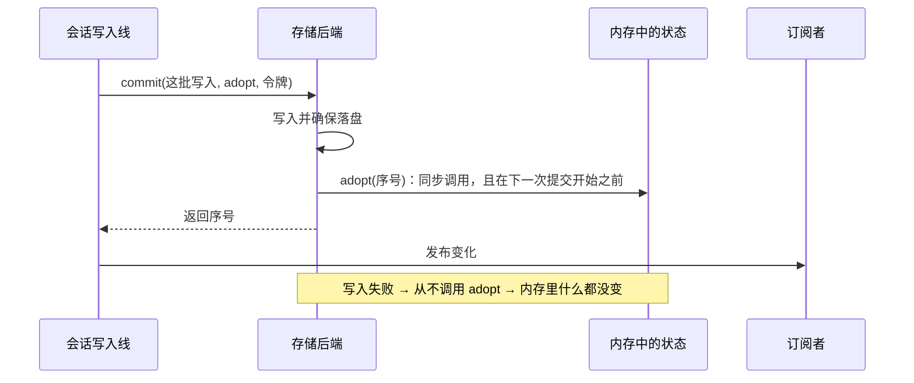

# 14 · 存储约定与错误三原则：刻完碑，才贴告示　🟠P1

> **本课目标**
> 1. 看懂存储后端必须遵守的约定：`commit(writes, adopt, context)`；
> 2. 会选存储后端：内存、SQLite、JSONL、IndexedDB、Cloudflare；
> 3. 记住错误处理的三条原则。
>
> **预计时间**：25 分钟

## 1. 先看图



## 2. 寓言：刻碑与告示

> 📜 **寓言 · 刻碑与告示**
>
> 县里的大事，要刻在石碑上；百姓看的，是衙门口告示栏上的抄件。
>
> 刻碑的石匠和抄告示的书吏之间，有一条死规矩：**石匠说“刻完了”，书吏才能贴；而且要马上贴，石匠开始刻下一块碑之前就得贴好。**
>
> 有个新来的书吏图快，石匠刚刻了一半，他就把告示先贴了出去。当天下午石匠的凿子崩了，那块碑只刻了半截，作废重刻。可告示栏上的东西已经被半个县的人看过，传得满城风雨，收都收不回来。
>
> 还有一回，书吏偷懒，攒了三块碑才去贴告示。百姓看到的告示栏，一会儿缺这条、一会儿缺那条，谁也说不清县里到底定了什么。
>
> 最吓人的一次，是石匠刻到一半，整块石头裂了。县太爷当即下令：<strong>今天衙门关门。</strong>不许任何人凭记忆去猜碑上刻了什么，也不许谁先把告示贴出去再说。第二天，衙门重新开门，大家站在碑前，从第一块读到最后一块完好的——碑上有什么，告示栏上就贴什么。
>
> 至于有百姓来问“去年三月的告示还在不在”，书吏翻了翻说“没有这一张”——这只是一个人问错了，衙门当然照常办公。书吏自己抄错了一张告示，撕了重抄就是，也不至于关门。
>
> 老书吏教新人：“<strong>碑上没有的，告示栏上就不能有。</strong>石头裂了，宁可关门一天，也不能让告示栏比石碑先说话。”

<details>
<summary>🔍 揭晓：故事里的东西分别是什么？</summary>

| 故事里 | pi-durable 里 |
|---|---|
| 石碑 | 存储后端里落盘的数据 |
| 告示栏 | 内存中的状态，以及发给订阅者的变化 |
| 石匠说“刻完了”才贴 | 后端在这批写入**落盘之后**才调用 `adopt(seq)` |
| 马上贴，刻下一块之前就贴好 | `adopt` **同步**调用，且在**下一次提交开始之前** |
| 先贴后刻、刻了一半作废 | 内存先于存储 → 崩溃后内存和存储对不上（被禁止） |
| 攒了三块才贴 | 内存落后存储、顺序错乱（也被禁止） |
| 石头裂了，衙门关门 | 原则 ①：**存储出错 → 整个运行底座结束**，要重新打开 |
| 重新开门，照碑贴告示 | 重新打开存储：提交是原子的，所以存储是一致的 |
| 百姓问了一张不存在的告示 | 原则 ②：**非法的读取只让那次调用失败** |
| 书吏抄错一张，撕了重抄 | 原则 ③：**你的代码出错只影响它自己那一块** |

</details>

## 3. 概念拆解

### 3.1 存储后端的约定

自定义后端的 `commit(writes, adopt, context)` 必须：

1. 在这批写入**落盘之后**调用 `adopt(seq)`；
2. **同步**调用，并且在它的下一次提交开始**之前**；
3. 然后以 `seq` 结束；
4. 在落盘之前就失败的提交，**从不**调用 `adopt`。

`adopt` 就是会话在内存中接受这批变化的动作，所以**内存永远不会出现“半本账”**。第 1 课的源码里，`adopt` 没被调用就提交成功，会被当成存储的故障处理。[^storage]

官方提供一套**一致性测试**，自定义后端可以直接跑：

```ts
import { registerStorageConformance } from "@earendil-works/pi-durable/testing";
registerStorageConformance({ describe, expect, it }, "我的存储", async (use) => { /* 打开、use(storage)、关闭 */ });
```

### 3.2 选哪个后端

| 后端 | 怎么打开 | 要点 |
|---|---|---|
| 内存 | `new MemoryStorage()` | 什么都不持久，适合测试 |
| SQLite | `openNodeSqliteStorage(文件)` | 一个数据库文件；WAL 模式 + `synchronous = NORMAL`：**提交扛得住进程崩溃**，但断电或宿主故障时可能丢最新的一次 |
| JSONL | `openNodeJsonlStorage(目录, 令牌)` | 只追加的文件；`{ fsync: true }` 每次提交前刷盘；**整个历史也留在内存里**，长期运行的智能体请用 SQLite |
| IndexedDB | `IndexedDbStorage.open(名字)` | 浏览器里用；同一时间只能有一个持有者，用 Web Lock 包住它的生命周期 |
| Cloudflare | `openDurableObjectSqliteStorage(ctx.storage)` | Durable Object 的 SQLite；提交就是它的存储事务 |

还有两条：**同一时间只有一个进程拥有一个存储，没有跨进程锁**；只想“看”别人在驱动的会话，用 `readOnly: true` 打开，所有写入都会被拒绝。

### 3.3 错误三原则

| 原则 | 发生什么 |
|---|---|
| ① **存储错误结束运行底座** | 出错的那次调用以原错误失败；之后的一切、所有挂着的等待都以 `SessionFailed` 失败；订阅以 `failed` 结束；运行中的任务收到中止信号；然后底座自己关闭。**不重试**，重新打开来恢复。 |
| ② **非法的读取只让那次调用失败** | 坏游标、不存在的对话、文档没保留的历史 → `StorageRequestError`，只影响这次读。注意只限**读**：`commit()` 里的任何错误都按原则 ① 处理。 |
| ③ **你的代码只影响它自己那一块** | 任务阶段抛错 → 那个任务故障；工具抛错 → 一条错误结果；钩子抛错 → 报告并跳过（`beforeTool` 则拦下调用）；提交回调抛错 → 那次提交回滚。 |

宿主可以这样在失败后重启：

```ts
harness.closed.then((end) => {
  if (end.reason === "failed") 重新打开(end.error);
});
```

为什么存储一出错就“关门”，而不是重试？因为不确定那次写入到底成没成——内存要么领先存储，要么落后存储，继续跑下去只会把错误放大。**重新打开**是唯一能确定“存储里到底有什么”的办法，而提交是原子的，所以重开后的存储一定是一致的；配合请求号（第 4 课），重新提交也不会重复。[^errors]

## 4. 思考题

1. SQLite 用 `synchronous = NORMAL` 而不是 `FULL`，换来了什么、牺牲了什么？
<details><summary>参考答案</summary>

换来了更快的提交（不必每次都等磁盘真正刷完）；牺牲的是断电或宿主故障时可能丢掉**最新的一次**提交。但因为提交是原子的，丢的只会是“完整的最后一页”，不会出现半页——重开后的世界仍然自洽，只是回到了稍早的一页。

</details>

## 小结

**碑上没有的，告示栏上就不能有。**

👉 源码：[`src/session/session.ts` 第 693 行（adopt）](https://github.com/earendil-works/pi/blob/136b87e8a7f5a3e5186de0289523ba327dc592fc/packages/durable/src/session/session.ts#L693)　·　规范 §10 存储约定：<https://github.com/earendil-works/pi/blob/136b87e8a7f5a3e5186de0289523ba327dc592fc/packages/durable/docs/spec.md#10-storage-contract>

[^storage]: 官方说明“存储”一节：<https://github.com/earendil-works/pi/blob/136b87e8a7f5a3e5186de0289523ba327dc592fc/packages/durable/README.md#storage>
[^errors]: 官方说明“错误”一节：<https://github.com/earendil-works/pi/blob/136b87e8a7f5a3e5186de0289523ba327dc592fc/packages/durable/README.md#errors>
