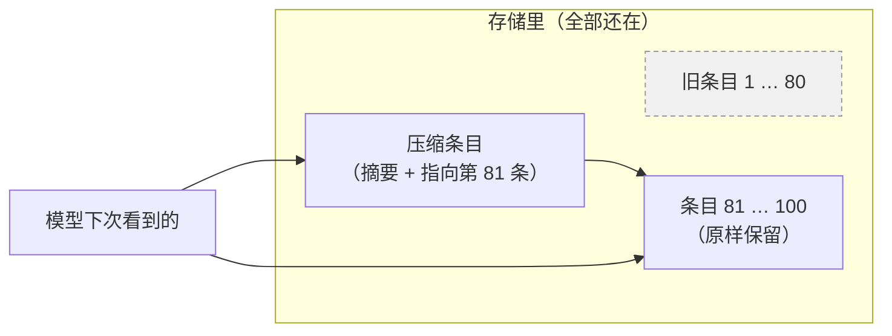

# 15 · 上下文压缩：把旧日志写成一页摘要　⚪P2

> **本课目标**：知道压缩做了什么、什么时候自动发生、旧记录去了哪里。　**预计时间**：15 分钟

## 1. 先看图



## 2. 寓言：船长的航海日志

> 📜 **寓言 · 船长的航海日志**
>
> 远洋船出海一年，航海日志已经写满了三大本。新上船的领航员要接手夜班，船长让他“先把日志看一遍”。领航员翻了一夜，才看到第二个月。
>
> 第二天，船长在最新一本日志的前面夹了一页纸，写得工工整整：“截至今日：我们从南港出发，绕过风暴角，补给过两次淡水，左舷第二块船板漏过水已修好，现在正向东驶向群岛。”再往后，是最近十天原原本本的记录。
>
> 船长写这页纸的时候，船并没有停下来，舵手照样掌舵。写好了，他等到换班的钟声响起，才把纸夹进去。
>
> 旧的那三大本，船长没扔，锁进了舱底的箱子。真要查“三月十二日那天风向如何”，开箱就能翻到。
>
> 后来又有一回，大副也写了一页摘要，可只总结到第五个月；船长那页已经总结到第十个月了。船长把大副那页退了回去：“我这页盖得更远，用我的。”
>
> 新领航员只看那一页纸和最近十天的记录，一顿饭的工夫就接上了班。他这才明白，**船长不是要他记住所有的事，是要他知道现在该往哪儿开。**

<details>
<summary>🔍 揭晓：故事里的东西分别是什么？</summary>

| 故事里 | pi-durable 里 |
|---|---|
| 写满的日志 | 越来越长的对话上下文 |
| 领航员读不完 | 上下文快超出模型的窗口 |
| 夹进去的那页摘要 | **压缩条目**（`pi.compaction`）：存着摘要，并指向第一条保留的条目 |
| 最近十天原样保留 | `keepRecentTokens`：大约保留这么多最近的上下文 |
| 写摘要时船不停 | 生成摘要期间对话照常工作 |
| 等换班钟声才夹进去 | 空闲时立即放入，否则在下一个回合边界放入 |
| 旧日志锁进箱子 | 旧条目**仍在存储里**，只是模型不再看到 |
| 大副那页盖得不够远 | 切点比当前上下文起点还早的摘要会作废（`stale`），**切得最远的那个生效** |

</details>

## 3. 概念拆解

```ts
const id = await root.compact("保留失败的测试名", context);   // 手动压缩，可附加要求
```

自动压缩由设置控制：

```ts
settings: {
  compaction: {
    enabled: true,            // 自动压缩；手动 compact() 总是可用
    reserveTokens: 16384,     // 超过“上下文窗口 - 这个数”时，下一次请求要先等压缩
    keepRecentTokens: 20000,  // 大约保留多少最近的上下文原样不动
    backgroundTokens: 32768,  // 比上面的阈值再低这么多时，就在后台提前开始压缩；0 关闭
    modelOverrides: { "local/small-32k": { reserveTokens: 4096, keepRecentTokens: 8000, backgroundTokens: 4096 } },
  },
}
```

- 服务方因为上下文太长拒绝请求时：先压缩，再**重试一次**。
- 生成摘要的花费也记在 `pi.usage` 里。
- `CompactionTask` 上的钩子 `beforeCompact` 可以拒绝压缩，或者自己提供摘要。
- 进行中的压缩显示在 `pi.live` 的 `compactions` 里，最近一次失败在 `compactionFailure` 里。
- **重置**（`root.reset()`）和压缩不同：重置让模型从零（或一段交接说明）开始，不做摘要。[^compaction]

## 4. 思考题

1. 压缩本身是一个任务。它在生成摘要时进程崩溃了，会怎样？
<details><summary>参考答案</summary>

它和别的任务一样有检查点，重启后从检查点继续（请求模型的部分会重做）。在它结束之前，对话照常用完整的上下文工作；摘要只有在成功后才在边界上放入。

</details>

## 小结

**不是要记住所有的事，是要知道现在该往哪儿开。**

👉 源码：[`src/harness/compaction.ts`](https://github.com/earendil-works/pi/blob/136b87e8a7f5a3e5186de0289523ba327dc592fc/packages/durable/src/harness/compaction.ts)　·　官方示例：[`24-compaction.ts`](https://github.com/earendil-works/pi/blob/136b87e8a7f5a3e5186de0289523ba327dc592fc/packages/durable/test/examples/24-compaction.ts)

[^compaction]: 官方说明“压缩”“重置与交接”两节：<https://github.com/earendil-works/pi/blob/136b87e8a7f5a3e5186de0289523ba327dc592fc/packages/durable/README.md#compaction>
