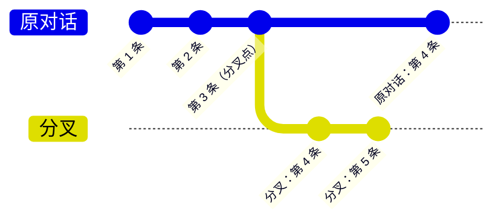

# 16 · 多个对话与分叉：棋谱上的岔路　⚪P2

> **本课目标**：会创建新对话、从某条记录分叉，知道分叉继承什么、不继承什么。　**预计时间**：10 分钟

## 1. 先看图



## 2. 寓言：棋谱上的岔路

> 📜 **寓言 · 棋谱上的岔路**
>
> 两位老棋友复盘一局棋。下到第三十手，一位说：“这里要是不跳马，改出车，会怎样？”
>
> 他们没有把棋谱上第三十手之后的记录擦掉。另一位拿来一张新纸，在开头写：“接主谱第三十手”，然后从第三十一手开始，往下摆“出车”的变化。主谱还是主谱，一个字没动；新纸上的变化，自顾自地往下走。
>
> 新纸不用把前三十手再抄一遍——要看前面，翻主谱就行。不过新纸有自己的编号，跟主谱不是同一个；寄给棋社请人点评时，人家不会把它和主谱当成同一份东西。
>
> 那天下午，他们从第三十手、第四十二手、第五十手，一共拉出了五张新纸。**主谱一直只有一份，每一条岔路都只是从某一手“接上”它。**

<details>
<summary>🔍 揭晓：故事里的东西分别是什么？</summary>

| 故事里 | pi-durable 里 |
|---|---|
| 主谱 | 原对话 |
| 新纸，“接主谱第三十手” | **分叉**：`root.fork(entryId, …)`，看得到原对话直到 `entryId` 的条目 |
| 不用重抄前三十手 | 分叉不复制旧条目，只是“接上” |
| 新纸有自己的编号 | 分叉得到**新的服务方会话标识**（`pi.provider`） |
| 寄去点评不会混淆 | 服务方的缓存与会话亲和按新标识区分 |

</details>

## 3. 概念拆解

```ts
const other = await harness.createConversation({ ownership: { kind: "ownerless" } }, context); // 一个全新的对话
const fork  = await root.fork(entryId, { ownership: { kind: "ownerless" } }, context);        // 从某条记录分叉
```

- 分叉看得到父对话直到 `entryId` 的条目，之后独立发展。
- 分叉保留父对话**在那条记录时**的智能体配置，但获得一个**新的**服务方会话标识。
- 两者都接受 `agent`（配置）和 `init`（在创建的那次提交里写入你的文档）。
- 你自己的文档在分叉时怎么办，由定义里的 `fork` 决定：`"initial"` 从初始值开始，`"current"` 复制当前值，`"asOf"` 取分叉点那时的值（第 7 课）。
- `HarnessOptions.conversationCreated(tx, conversation)` 会在**每一次**创建或分叉对话的提交里运行，适合给每个对话都备好你的文档。[^forks]

## 4. 思考题

1. 分叉以后，在分叉里新加的记录会出现在原对话里吗？反过来，原对话后来新加的记录，分叉看得到吗？

<details><summary>参考答案</summary>

都不会。分叉只看得到父对话**到 `entryId` 为止**的条目，之后两边各走各的——就像棋谱从同一步分出两条线，在一条线上落的子，不会出现在另一条线上。

</details>

2. 你有一个“购物车”文档。希望分叉出来的对话里，购物车是**分叉点那一刻**的内容，而不是父对话现在的内容。文档定义里的 `fork` 该选哪个？

<details><summary>参考答案</summary>

选 `"asOf"`：取分叉点那时的值。`"current"` 会复制父对话**现在**的值（分叉点之后可能已经改过了），`"initial"` 则从初始值（空购物车）开始。

</details>

## 小结

**主谱只有一份，每条岔路都只是从某一手接上它。**

👉 官方示例：[`02-forks.ts`](https://github.com/earendil-works/pi/blob/136b87e8a7f5a3e5186de0289523ba327dc592fc/packages/durable/test/examples/02-forks.ts)　·　规范 §3.7 分叉：<https://github.com/earendil-works/pi/blob/136b87e8a7f5a3e5186de0289523ba327dc592fc/packages/durable/docs/spec.md#37-forks>

[^forks]: 官方说明“更多对话与分叉”“你自己的状态”两节：<https://github.com/earendil-works/pi/blob/136b87e8a7f5a3e5186de0289523ba327dc592fc/packages/durable/README.md#more-conversations-and-forks>
