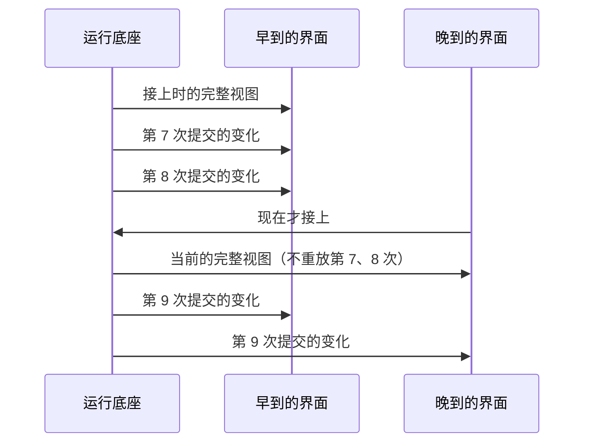

# 17 · 订阅变化与多人协作：茶馆说书　⚪P2

> **本课目标**：会用 `watch()` 驱动界面，知道晚到的人看到什么、跟不上的人会怎样。　**预计时间**：15 分钟

## 1. 先看图



## 2. 寓言：茶馆说书

> 📜 **寓言 · 茶馆说书**
>
> 茶馆里，说书先生每天讲一段《三国》。
>
> 早来的茶客从头听起。说书先生每讲完一小节，堂倌就在门口的小黑板上添一句：“刘备三顾茅庐，见到了诸葛亮。”
>
> 晚来的茶客一进门，先看一眼小黑板，就知道书说到了哪儿——没有人要求说书先生倒回去重讲一遍。他找个座位坐下，接着往下听。
>
> 有位老茶客听着听着睡着了。醒来时，说书先生已经讲了一百多个小节。堂倌没让他一节一节去补，只递给他一张今天最新的“前情提要”：“现在讲到赤壁了。”
>
> 城里另有几家小茶馆，请不起说书先生，就派个伙计坐在这儿，听一句，往外跑着传一句。那几家的茶客，听到的和这里一模一样。
>
> 说书先生有条规矩：<strong>自己没说出口的，谁也不许往黑板上写。</strong>所以不管来得早晚、坐得远近，大家听到的，都是同一个故事。

<details>
<summary>🔍 揭晓：故事里的东西分别是什么？</summary>

| 故事里 | pi-durable 里 |
|---|---|
| 说书先生讲完一小节 | 一次提交 |
| 早来的茶客从头听 | `watch()`：先给接上时的视图，之后每次相关提交给一次变化 |
| 晚来的茶客看一眼黑板 | **晚加入**：从当前视图开始，**不重放**历史 |
| 睡着的老茶客拿到最新提要 | 跟不上的订阅最多攒 100 帧，超过后换成一帧**完整的最新视图** |
| 跑腿传话的伙计 | 把每次提交的变化操作（ops）转发给远程客户端，对方照样应用 |
| 没说出口的不许写 | 只有已提交的状态可见（第 1 课） |

</details>

## 3. 概念拆解

```ts
const watch = await root.watch(context);
render(watch.value);                        // 接上时的状态
watch.start(async (value, ops) => {
  // value.entries：当前上下文的条目
  // value.docs["pi.live"]：进行中的回答（流式部分、重试）和工具调用（输出、详情）
  // value.docs["pi.inbox"]、["pi.usage"]、["pi.agent"]、["pi.provider"]
  render(value);
  await 发给远程客户端(ops);
});
// 不看了：await watch.stop();
```

- 一个订阅只会结束一次，结束原因有：`stopped` 主动停、`cancelled` 令牌被取消、`retired` 文档退役、`ended` 底座关闭、`listener_error` 回调出错、`failed` 底座失败。
- 流式回答和工具输出默认**最多每 100 毫秒提交一次**，所以界面上的“打字效果”也是已提交的状态；远程存储可以调慢：`settings.progress = { partialIntervalMs: 500, outputIntervalMs: 500 }`。
- 想要“消息开始 / 消息更新 / 工具开始”这类事件流，可以用实验性的 `watchEvents(harness, root.id, context)`。
- 单独订阅一个文档：`harness.watchDoc()`；订阅整棵任务树：`harness.watchTaskGraph()`（第 11 课）。[^watch]

## 4. 思考题

1. 为什么界面上的“打字效果”也要先提交（最多每 100 毫秒一次），而不是把模型吐出的每个字直接推给界面？

<details><summary>参考答案</summary>

因为订阅者看到的必须是**已提交的状态**：断线重连、换一台机器接上、多个客户端同时看，大家看到的都一样；崩溃后也不会出现“界面上看见过、账本里却没有”的内容。代价是写入次数变多，所以远程存储可以把间隔调大（`partialIntervalMs`）。

</details>

2. 你的订阅回调里抛了一个异常，会怎样？会把底座弄崩吗？

<details><summary>参考答案</summary>

不会。这个订阅以 `listener_error` 结束（一个订阅只结束一次），`onReport` 会收到一条 `listener_error`；底座和其他订阅照常工作。需要的话重新订阅即可。

</details>

## 小结

**说书先生没说出口的，谁也不许往黑板上写；所以来得早晚，听到的都是同一个故事。**

👉 官方示例：[`20-late-join.ts`](https://github.com/earendil-works/pi/blob/136b87e8a7f5a3e5186de0289523ba327dc592fc/packages/durable/test/examples/20-late-join.ts)　·　规范 §9 文档观察：<https://github.com/earendil-works/pi/blob/136b87e8a7f5a3e5186de0289523ba327dc592fc/packages/durable/docs/spec.md#9-document-observation-and-chord>

[^watch]: 官方说明“订阅一个对话”一节：<https://github.com/earendil-works/pi/blob/136b87e8a7f5a3e5186de0289523ba327dc592fc/packages/durable/README.md#watching-a-conversation>
