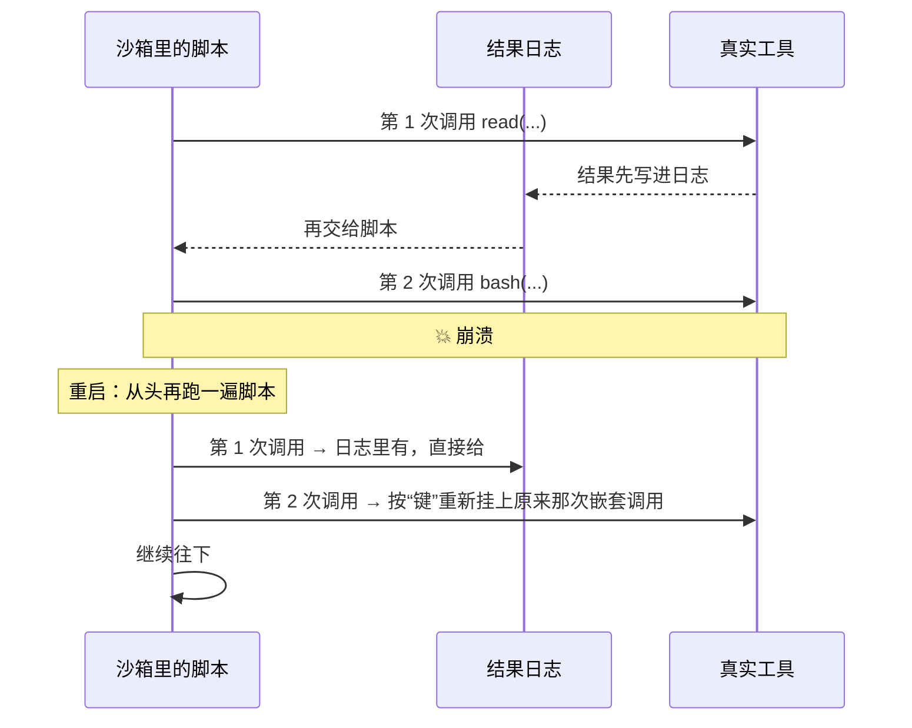

# 18 · 代码模式：照着录音重演的木偶戏　⚪P2

> **本课目标**：知道代码模式是什么，以及它靠“确定性 + 结果日志”扛住重启的原理。　**预计时间**：15 分钟

## 1. 先看图



## 2. 寓言：照着录音重演的木偶戏

> 📜 **寓言 · 照着录音重演的木偶戏**
>
> 有个木偶戏班演一出互动戏。演到关键处，木偶会停下来问台下：“往左走，还是往右走？”台下喊什么，木偶就照着演下去。班主在台侧放了一台录音机，**台下每喊一次，先录下来，再让木偶照着演。**
>
> 演到第三次提问时，戏台停电了。
>
> 来电以后，班主没有从第三次提问接着演——木偶的胳膊腿摆在什么位置，谁也记不清了。他让木偶**从头**演起。演到第一次提问，他不问台下，而是按下录音机：“往左！”木偶往左。第二次提问，录音机：“往右！”木偶往右。动作和停电前分毫不差，因为剧本是同一个剧本，连抽签用的那副签，都是按同样的顺序洗的。
>
> 录音放完了，戏也演到了第三次提问。这时班主才重新转向台下：“往左，还是往右？”
>
> 只有一回出了岔子：新来的木偶师傅手一抖，在录音之外让木偶多问了一个问题。录音对不上了。班主当场叫停，宁可这场戏不演完，也不能让木偶按一段**对不上的录音**乱演。
>
> 散场后，徒弟问班主为什么不干脆记下每个木偶的姿势。班主说：“姿势记不全，也记不准。**只要剧本不变、签的顺序不变、台下的回答一样，木偶自己就会走回原来的位置。**”

<details>
<summary>🔍 揭晓：故事里的东西分别是什么？</summary>

| 故事里 | pi-durable 里 |
|---|---|
| 木偶戏的剧本 | 模型写的 JavaScript 脚本 |
| 问台下 | 脚本调用工具：`await tools.<名字>(参数)`，每次都是一次嵌套工具调用 |
| 录音机 | **结果日志**（`pi.codemode.journal`）：每个结果先写进日志，再交给脚本 |
| 从头演、照录音给答案 | 重启后**重跑脚本**，按原来的顺序把日志里的结果交给它 |
| 同样顺序洗的签 | 确定性的沙箱：虚拟时钟、带种子的随机数、UTC 时区 |
| 录音放完再问台下 | 日志用完后，正常调用工具；被打断的那次按“键”重新挂上原来的嵌套调用 |
| 多问了一个问题，叫停 | 脚本走了另一条路（调用不同、顺序不同）→ 这次调用以错误结束 |
| 不记姿势 | 不保存 JS 虚拟机的内存快照，只保存“外部给了它什么” |

</details>

## 3. 概念拆解

```ts
import { CodemodeSandbox } from "@earendil-works/pi-codemode";
import { createCodemodeExtension } from "@earendil-works/pi-durable/codemode";

registry.install(createCodemodeExtension({ sandbox: new CodemodeSandbox({ memoryLimitBytes: 256 * 1024 * 1024 }) }));
```

- 加上一个 `codemode` 工具：模型写 JavaScript，在 QuickJS 沙箱里调用对话的工具；**只有脚本的输出**回到模型。
- 还会加一个提示词段落，在令牌预算内以 TypeScript 声明的形式列出脚本可调用的工具；其余的用 `searchTools()`、`describeTool()` 查。
- 重跑以错误结束的几种情况：脚本走了另一条路、沙箱的指纹或代码模式的版本变了。[^codemode]
- 这其实是第 3 课“效果三明治”的又一种用法：**外部给的每个结果都先提交，再交出去**。

## 4. 思考题

1. 脚本里调用了一次“发邮件”工具，之后进程崩溃。重跑脚本时，邮件会再发一次吗？

<details><summary>参考答案</summary>

不会。每个工具调用的结果都是**先提交进日志，再交还给脚本**的。重跑时脚本照着日志“重演”：已经有记录的调用直接拿记录里的结果，不再真的执行——就像木偶照着录音再演一遍，台词不会变。

</details>

2. 什么情况下重跑会直接以错误结束？为什么不“将错就错”继续跑？

<details><summary>参考答案</summary>

脚本走了另一条路（调用的顺序或参数和日志对不上），或者沙箱的指纹、代码模式的版本变了。这时日志里的结果已经不对应现在的调用，硬用就可能把 A 调用的结果交给 B。宁可明确报错，也不悄悄给出错误的结果。

</details>

## 小结

**只要剧本不变、签的顺序不变、台下的回答一样，木偶自己就会走回原来的位置。**

👉 源码：[`src/codemode/codemode.ts`（文件开头的设计说明）](https://github.com/earendil-works/pi/blob/136b87e8a7f5a3e5186de0289523ba327dc592fc/packages/durable/src/codemode/codemode.ts#L1)　·　规范 §7.6：<https://github.com/earendil-works/pi/blob/136b87e8a7f5a3e5186de0289523ba327dc592fc/packages/durable/docs/spec.md#76-code-mode>

[^codemode]: 官方说明“代码模式”一节：<https://github.com/earendil-works/pi/blob/136b87e8a7f5a3e5186de0289523ba327dc592fc/packages/durable/README.md#code-mode>
