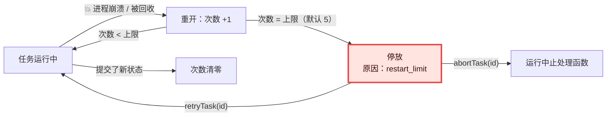

# 19 · 崩溃循环与重启上限：总晕倒的搬运工　⚪P2

> **本课目标**：知道为什么要给“重启”计数、任务被“停放”后怎么办。　**预计时间**：10 分钟

## 1. 先看图

## 2. 寓言：总晕倒的搬运工

> 📜 **寓言 · 总晕倒的搬运工**
>
> 码头仓库里有一只特别沉的木箱。搬运工老刘每次一弯腰去抬，就眼前一黑，晕倒在地。醒过来，工头让他接着抬——又晕了。
>
> 工头起初没在意，直到有人提醒他：“这箱子照这么抬下去，老刘能晕到明年。”
>
> 工头于是立了个规矩：<strong>谁在活干到一半时晕倒，就在他这件活上划一道。</strong>正常下班收工不算；只要往前挪了一步，就把划的道擦掉重新数。划满五道，这件活就贴上红条，挪到墙角，不许再抬，然后告诉掌柜一声——只说一次。
>
> 有天仓库突然停电，当时正在干活的所有人，手上的活都被划了一道。有几件活其实好好的，只是倒霉碰上了停电。所以掌柜每天早上都会看一眼墙角的红条，觉得哪件是冤枉的，就撕掉红条：“再试一次。”觉得那箱子确实有问题，就让人开箱拆散。
>
> 后来大家才明白，这条规矩不是为了惩罚老刘——**是为了不让一只箱子拖垮整个仓库。**

🔍 揭晓：故事里的东西分别是什么？

| 故事里 | pi-durable 里 |
|---|---|
| 一抬就晕的木箱 | 每次都在下一个检查点之前把进程搞崩的工作（耗尽内存、CPU） |
| 醒来接着抬 | 重开后自动恢复运行中的任务 |
| 划一道 | 重开时给被打断的任务**重启次数 +1** |
| 正常下班不算，挪一步就擦掉 | 正常关闭不计数；任务提交了新状态，计数清零 |
| 划满五道贴红条 | 达到 `settings.restartLimit`（默认 5）→ **停放**（parked） |
| 只告诉掌柜一次 | `onReport` 收到一次 `task_parked` |
| 停电时人人被划一道 | 进程死掉时，**所有**正在运行的任务都会被计数 |
| 撕红条再试一次 | `harness.retryTask(id)` |
| 开箱拆散 | `harness.abortTask(id)`：仍会运行它的中止处理函数 |

## 3. 概念拆解

- 被停放的任务：`inspect()` 和任务图里显示为被阻塞，原因 `restart_limit`；`wake()` 不把它算作活跃。
- `restartLimit: Infinity` 永不停放。
- 中止处理函数本身被打断这么多次，任务以 `faulted`（故障）结束。
- 因为一次停电会让所有运行中的任务都被计数，**界面上应该列出被停放的任务，并提供“重试”按钮**。
- `onReport(error, info)` 的 `info.type` 告诉你发生了什么：`session_failed`、`task_faulted`、`task_parked`、`migration_failed`、`task_outdated`、`task_error`、`extension_error`、`host_error`、`listener_error`。可以把某一类任务的 `task_faulted` 接到你自己的熔断器上。[^failures]

计数发生在第 2 课提到的调度器 `open()` 里：运行中 → 等待调度，重启次数 +1，达到上限就停放并报告。

👉 [`src/harness/scheduler.ts` 第 382 行](https://github.com/earendil-works/pi/blob/136b87e8a7f5a3e5186de0289523ba327dc592fc/packages/durable/src/harness/scheduler.ts#L382)

🕹️ 交互模拟器“总晕倒的搬运工”：请在网页版课程中打开。

## 4. 思考题

1. 如果没有重启上限，一个每次都在检查点之前把内存撑爆的任务会怎样？

参考答案

每次重启，`open()` 都把它从“运行中”改回“等待调度”，调度器再跑它，进程再崩——无限循环。而且每次崩溃都会打断同一进程里所有正在运行的任务，一个坏任务拖垮所有人。

2. 一个长任务每 10 分钟提交一次新状态，但机器每 5 分钟就断一次电。它会被停放吗？如果改成每 2 分钟提交一次呢？

参考答案

每 10 分钟提交：它永远到不了下一个检查点，每次断电计数 +1，第 5 次就被停放。每 2 分钟提交：每次断电前都已经提交过新状态，**新状态会让计数清零**，所以不会被停放，最终能做完。这也说明：检查点越密，越不容易被误判为崩溃循环。

3. 为什么文档建议在界面上列出被停放的任务并提供“重试”按钮，而不是自动无限重试？

参考答案

一次整机断电会让**所有**运行中的任务都被计数，健康的任务也可能“躺枪”被停放。到底是代码有 bug 还是环境出了问题，需要人来判断；判断完点重试（`harness.retryTask(id)`）即可。

## 小结

**这条规矩不是为了惩罚谁，是为了不让一只箱子拖垮整个仓库。**

[^failures]: 官方说明“失败与恢复”一节：<https://github.com/earendil-works/pi/blob/136b87e8a7f5a3e5186de0289523ba327dc592fc/packages/durable/README.md#failures-and-recovery>
